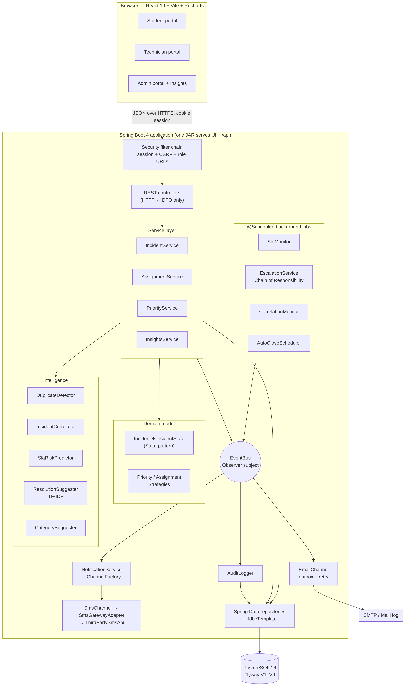

# BITSolve: Intelligent IT Service Management & Incident Resolution

CS F213 Object-Oriented Programming, BITS Pilani Hyderabad, Sem I 2026-27 · Group **[GROUP_NO]**

Campus IT incident management with three role-specific portals (Student, Technician, Administrator), a State-pattern lifecycle, runtime-switchable priority and assignment strategies, SLA monitoring with escalation, event-driven notifications (in-app, e-mail, simulated SMS), an immutable audit trail, and seven rule-based intelligent features. Java 25 · Spring Boot 4.1 · PostgreSQL · React 19 + Vite + Recharts.



## Quick start (one command)

```bash
cd bits-itsm
docker compose up --build
```

* App and UI: http://localhost:8080
* MailHog (e-mails sent by the app): http://localhost:8025
* The `dev` profile seeds demo users and 60 historical incidents (only into an empty database).

### Demo credentials (docker-compose / dev profile only)

Password for every demo account: `BitsolveDemo2026` (override with `DEMO_USER_PASSWORD`).

| Role | E-mail | Notes |
|---|---|---|
| Administrator | `admin01@hyderabad.bits-pilani.ac.in` | Also acts as team lead |
| Technician | `technician01@…` | Hardware |
| Technician | `technician02@…` | Software |
| Technician | `technician03@…` | Database |
| Technician | `technician04@…` | Network (use for the Wi-Fi demo) |
| Student | `student01@…` … `student04@…` | Reporters |

All e-mails end in `@hyderabad.bits-pilani.ac.in`.

## Feature checklist (brief → implementation)

| Brief requirement | Implementation |
|---|---|
| Register / login | ✅ Students self-register (institutional e-mail); staff accounts created by admins; role-specific login |
| Automatic classification | ✅ Service, impact, urgency and category detected from the report text; uncertain reports go to an admin review queue (`classification/`) |
| Employee adds information, responds to requests | ✅ Add information at any time while open; replies to technician questions resume the paused SLA |
| Report, classify, prioritise, assign, investigate, resolve, verify, close | ✅ All three portals; lifecycle enforced by the **State pattern** (`incident/state`) incl. `AWAITING_INFO` with paused SLA, reopen, and 72 h auto-close |
| ≥3 roles with different UI | ✅ Student (teal), Technician (indigo), Administrator (navy/amber) portals with their own home pages |
| Priority determination | ✅ impact, urgency, service criticality and number of affected users; 4 runtime-switchable strategies ([PRIORITY_ALGORITHM.md](bits-itsm/docs/PRIORITY_ALGORITHM.md)) |
| Technician assignment | ✅ Skill, Load, Round-robin, Priority-based, Smart recommendation + audited fallback; transfer/collaboration approvals |
| SLA management | ✅ Policies per priority with a per-service SLA factor, captured deadlines, background monitor (warning at 80 %, breach), compliance % |
| Notifications | ✅ Observer: in-app (persisted), e-mail outbox with retry, simulated SMS via **Adapter** |
| Audit trail | ✅ Immutable audit + per-incident history, admin filter |
| Search, filtering, reporting | ✅ 9 combinable criteria (API and UI), Insights & Analytics dashboards (Recharts), CSV + print-to-PDF export |
| ≥2 intelligent features | ✅ 7: duplicate detection, major-incident correlation, P1 escalation (Chain of Responsibility), smart technician recommendation, SLA-risk prediction, auto-categorisation, suggested resolutions (TF-IDF) |
| ≥2 design patterns | ✅ State, Strategy, Observer, Factory, Adapter, Chain of Responsibility, Repository ([DESIGN_PATTERNS.md](bits-itsm/docs/DESIGN_PATTERNS.md)) |
| Exception handling | ✅ `BitsolveException` hierarchy covering all 12 situations in the brief, consistent JSON errors `{timestamp,status,code,message,path}` |
| Persistence | ✅ PostgreSQL, Flyway V1–V9 |
| ≥15 documented test cases | ✅ 53 documented, ≈230 automated ([TEST_CASES.md](bits-itsm/docs/TEST_CASES.md)) |
| Innovation | ✅ Correlation, SLA-risk prediction, smart recommendation, TF-IDF suggestions, analytics dashboard, automated escalation, event-driven design, Docker + CI, cloud-ready |

Gaps and deliberate deviations are listed in [PLAN.md](bits-itsm/docs/PLAN.md) and [DECISIONS.md](bits-itsm/docs/DECISIONS.md).

## Documentation

| Deliverable | File |
|---|---|
| Full report (PDF) | `bits-itsm/docs/[GROUP_NO]_OOP_Report.pdf`. After filling names in `docs/TEAM.md` and `docs/build_report.py`, run `python3 docs/build_report.py` (needs pandoc), open `docs/report.html` in Chrome, Print → Save as PDF |
| Problem analysis | [PROBLEM_ANALYSIS.md](bits-itsm/docs/PROBLEM_ANALYSIS.md) |
| Requirements | [REQUIREMENTS.md](bits-itsm/docs/REQUIREMENTS.md) |
| Architecture | [ARCHITECTURE.md](bits-itsm/docs/ARCHITECTURE.md) |
| UML (PlantUML sources + PNG) | [docs/uml](bits-itsm/docs/uml): use case, 2 class diagrams (domain, patterns), state, 3 sequence diagrams |
| Technology stack (9 questions) | [TECH_STACK.md](bits-itsm/docs/TECH_STACK.md) |
| Database / ER | [DATABASE.md](bits-itsm/docs/DATABASE.md) |
| Patterns, priority, security, tests, decisions | `DESIGN_PATTERNS.md`, `PRIORITY_ALGORITHM.md`, `SECURITY.md`, `TEST_CASES.md`, `DECISIONS.md` |
| Team responsibilities | [TEAM.md](bits-itsm/docs/TEAM.md) |
| Demo video script | [DEMO_SCRIPT.md](bits-itsm/docs/DEMO_SCRIPT.md) |

## Running tests

```bash
cd bits-itsm/frontend && npm ci && npm test && npm run build
cd ../backend && ./mvnw verify                      # unit + MockMvc
BITSOLVE_DB_TESTS=true ./mvnw -Pcoverage verify      # + PostgreSQL integration, JaCoCo report in target/site/jacoco
```

PostgreSQL tests need a disposable database (see *Builds and tests* below). GitHub Actions (`.github/workflows/ci.yml`) runs all of the above on every push.

## Main API endpoints

| Area | Endpoints |
|---|---|
| Auth | `GET /api/auth/csrf`, `POST /api/auth/register`, `POST /api/auth/login`, `POST /api/auth/logout`, `GET /api/auth/me` |
| Incidents | `GET/POST /api/incidents` (filters: `search,status,category,priority,service,technician,from,to,sla`), `GET /api/incidents/my`, `GET /api/incidents/{id}`, `POST /api/incidents/{id}/{classify,acknowledge,start,notes,information,reply,comment,resolve,verify,close,feedback,edit}`, `GET /api/incidents/lifecycle` |
| Assignment | `POST /api/incidents/{id}/{assign,auto-assign}`, `GET /api/incidents/{id}/recommendations`, `GET/PUT /api/admin/assignment-strategy`, transfer/collaboration request endpoints |
| Priority & SLA | `GET/PUT /api/admin/priority-strategy`, `POST …/preview`, `GET/PUT /api/admin/sla-policies/{priority}`, `GET /api/admin/sla/violations`, `GET /api/admin/escalations` |
| Insights | `GET /api/admin/insights/{analytics,major-incidents,sla-risk}`, `GET /api/technician/sla-risk`, `GET /api/{technician,admin}/incidents/{id}/suggested-resolutions`, `GET /api/admin/reports/incidents.csv`, `GET /api/admin/sms-outbox` |
| Admin | users, catalog (services/categories), reports, audit, e-mail outbox under `/api/admin/**` |

## Folder structure

```text
bits-itsm/
├── backend/src/main/java/com/bits/itsm/
│   ├── incident/        Incident aggregate, lifecycle services, SLA policy capture
│   │   └── state/       State pattern: IncidentState + 9 state classes
│   ├── assignment/      Assignment strategies, registry/fallback, transfers, workload
│   ├── priority/        4 priority strategies + runtime settings
│   ├── sla/             SLA calculator, monitor, scheduled events, auto-close
│   ├── escalation/      Chain-of-Responsibility escalation
│   ├── event/ audit/    Observer subject, events, audit trail
│   ├── notification/    In-app, e-mail outbox, channel factory, sms/ Adapter
│   ├── intelligence/    Duplicates, correlation, SLA risk, TF-IDF, suggestions, categories
│   ├── exception/       BitsolveException hierarchy + global JSON errors
│   ├── api/             Insights/analytics/CSV, admin and service endpoints
│   ├── auth/ user/      Security, sessions, user inheritance, demo seeders
│   └── support/         Read-only snapshots for background jobs
├── backend/src/main/resources/db/migration   Flyway V1–V9
├── frontend/src         React portals, Insights (Recharts), API client
├── docs/                Report, UML, design documents, demo script
├── Dockerfile           React + Spring Boot in one image
└── docker-compose.yml   PostgreSQL + app + MailHog
```

## Verification status (21 Nov 2026)

* 136 backend unit tests run here pass (the Mockito/Spring/PostgreSQL suites need the real Maven build); Flyway V1–V9 applied to PostgreSQL 16; demo seeder verified on PostgreSQL; frontend tests (5/5) and production build pass; Insights page checked in headless Chromium.
* **Before submitting**, run `./mvnw verify` (and the PostgreSQL suite) on a machine with Maven Central access: the final-stage changes could not be built with the real Spring/Hibernate libraries in the environment where they were written.

---

# Operational details (team notes)


## Implemented

- Session authentication, BCrypt passwords, CSRF protection and role authorization. Disabled accounts lose access on their next request.
- Incident reporting, editing before classification, assignment, investigation, replies, resolution, verification, reopening, closure and feedback.
- Persisted priority and assignment strategies, technician skills/capacity, transfer and collaboration approvals.
- Captured response/resolution deadlines, durable warning/breach deduplication and P1 escalation.
- Persistent notifications, read state, audit history and a Gmail student email outbox. SMTP delivery requires configuration; legacy simulated rows are never sent.
- Admin user/catalog management, criticality, policies, reports and audit pages.
- Rule-based category and duplicate suggestions; technician library of verified resolutions.

Operational pages use Java APIs. Development previews at `?preview=student`, `?preview=technician` and `?preview=admin` exist only in Vite development mode and do not authenticate users or save data.

## Local setup (PowerShell)

Install Java 25, Node.js 24 and PostgreSQL. Create an empty database:

```powershell
createdb -U postgres bitsolve
cd bits-itsm/backend
$env:DB_URL='jdbc:postgresql://localhost:5432/bitsolve'
$env:DB_USER='postgres'
$env:DB_PASSWORD='<database password>'
$env:BOOTSTRAP_ADMIN_EMAIL='<institutional email>'
$env:BOOTSTRAP_ADMIN_PASSWORD='<unique password of at least 12 characters>'
.\mvnw.cmd spring-boot:run
```

Bootstrap creates the first administrator only when none exists. Remove the bootstrap variables afterward. Create accounts under **Manage Users**, then configure technician skills and availability under **Manage Technicians**. Institutional addresses must end in `@hyderabad.bits-pilani.ac.in`.

For optional local demo accounts, set `SPRING_PROFILES_ACTIVE=dev`, `BITSOLVE_DEMO_SEED_ENABLED=true` and a unique `DEMO_USER_PASSWORD`. Existing passwords are never overwritten. Do not enable demo seeding in production.

In a second terminal:

```powershell
cd bits-itsm/frontend
npm.cmd ci
$env:BACKEND_URL='http://localhost:8080'
npm.cmd run dev
```

Open the URL printed by Vite. Keep database credentials in environment variables, not committed files.

## Database

Flyway migrations are in `backend/src/main/resources/db/migration`; Hibernate validates the schema.

- V1 creates/adopts Phase 4 tables and adds missing profile/SLA columns without deleting rows.
- V2 adds lookup indexes, pending-request uniqueness and integrity constraints.
- V3 captures missing legacy SLA targets from creation timestamps and existing policies without replacing saved deadlines.

Tables: `app_users`, `technician_skills`, `catalog_entries`, `incidents`, `incident_collaborators`, `transfer_requests`, `collaboration_requests`, `investigation_notes`, `incident_history`, `incident_feedback`, `sla_policies`, `assignment_settings`, `priority_settings`, `notification_deliveries`, `audit_events`, `scheduled_events` and Flyway version history. Assignment/resolution fields belong to incidents; support messages belong to investigation notes.

Existing unversioned Phase 4 databases are baselined at version 0. Back up existing data before upgrading. Contradictory pending requests cause a migration failure rather than automatic deletion. Do not edit migrations after applying them to a shared database. Empty legacy files under `database/` are not startup scripts.

Service/category codes retain the existing Java taxonomy. Administrators can rename and enable/disable entries and set service criticality. Existing incidents keep their original priority/deadline snapshots.

New service records start disabled with no criticality. An administrator must select
LOW, MEDIUM or HIGH in IT Services before enabling them. V6 permits unconfigured
values without modifying existing service values or incident snapshots. Review old
MEDIUM settings manually: previous defaults cannot be distinguished reliably from
explicit administrator choices. V1-V5 remain unchanged, including V3's historical
backfill; the live priority calculation no longer has a MEDIUM fallback.

After upgrading a backup copy of the database, verify V6 succeeds, existing incident
priorities/deadlines and service settings are unchanged, and a newly initialized
service cannot be used until configured. Test session expiry by removing the browser
session cookie and opening a protected page; the existing login should appear.

## Builds and tests

```powershell
cd bits-itsm/frontend
npm.cmd run build
cd ../backend
.\mvnw.cmd verify
```

The backend includes `frontend/dist` in its executable JAR when present. Build React first, then start `java -jar target/bitsolve-backend-0.0.1-SNAPSHOT.jar`. React and `/api` share port 8080 or `PORT`.

PostgreSQL tests are opt-in and truncate their incident test tables. Use a separate disposable database:

```powershell
$env:BITSOLVE_DB_TESTS='true'
$env:BITSOLVE_TEST_DB_URL='jdbc:postgresql://localhost:5432/bitsolve_test'
$env:DB_USER='<test database user>'
$env:DB_PASSWORD='<test database password>'
$env:DEMO_USER_PASSWORD='<test-only password>'
.\mvnw.cmd verify
```

Without that opt-in, database tests are explicitly skipped; unit/MVC tests still run. Reports are in `backend/target/surefire-reports`.

## Railway deployment (manual)

1. Connect the repository and set the application service root directory to `bits-itsm`. Its Dockerfile builds React and Spring Boot together.
2. Add PostgreSQL. Configure `DB_HOST`, `DB_PORT`, `DB_NAME`, `DB_USER` and `DB_PASSWORD` from its connection variables, or use JDBC `DB_URL` plus user/password. A plain `postgresql://` URL is not a JDBC URL.
3. Set `SPRING_PROFILES_ACTIVE=prod` and `SESSION_COOKIE_SECURE=true`. Use administrator bootstrap variables only for first setup. Leave demo seeding disabled.
4. Deploy, configure health check `/api/health`, and generate an HTTPS domain. The application reads Railway's `PORT` automatically.
5. Verify incident lifecycle, transfer/collaboration and notification persistence after restart.

Railway deployment, the Docker image build and hosted HTTPS behavior require verification in the deployment environment. Real Gmail delivery has not been tested with credentials.

Deployment references: [Railway Docker builds](https://docs.railway.com/builds/dockerfiles), [PostgreSQL variables](https://docs.railway.com/databases/postgresql), and [health checks](https://docs.railway.com/deployments/healthchecks).

## Java OOP

`User`, `Student`, `Technician` and `Administrator` demonstrate inheritance and encapsulation. `PriorityStrategy` and `AssignmentStrategy` demonstrate abstraction and polymorphism. `EventBus`/`IncidentObserver` implement Observer; `NotificationFactory` implements Factory; `RepositoryIncidentLookup` adapts JPA entities to immutable snapshots. Entity methods enforce lifecycle rules.

## Student Gmail notifications

Configure these backend environment variables, then restart:

| Variable | Value / default |
|---|---|
| MAIL_USERNAME | Gmail sender address (required for sending) |
| MAIL_APP_PASSWORD | Google App Password (required for sending; not your normal password) |
| APP_BASE_URL | Optional public app URL, e.g. https://bitsolve.example |
| MAIL_CONNECTION_TIMEOUT_MS | 5000 |
| MAIL_READ_TIMEOUT_MS | 5000 |
| MAIL_WRITE_TIMEOUT_MS | 5000 |
| MAIL_POLL_INTERVAL_MS | 30000 |
| MAIL_RETRY_SECONDS | 60 |

The sender uses smtp.gmail.com:587 with mandatory STARTTLS. Google App Passwords require 2-Step Verification and may be restricted by your account administrator: [Google instructions](https://support.google.com/mail/answer/185833?hl=en).

Only INCIDENT_RECEIVED, WORK_STARTED and INCIDENT_RESOLVED are queued, addressed to the reporter stored in PostgreSQL. No administrator/technician email is generated. The queue insert shares the incident transaction; a separate worker sees only committed messages. Missing credentials leave PENDING rows untouched, with zero attempts. In-app notification rules remain unchanged.

Delivery uses at most three attempts, with delays of 60 then 120 seconds by default (plus polling). A database lock prevents concurrent workers sending the same queue. The stable incident/event key prevents repeated updates or reopening from generating another email of the same kind. Status is PENDING, SENDING, SENT or FAILED; each genuine attempt is audited. SENT means the SMTP sender returned successfully, not proof that the recipient read the email. Inspect GET /api/admin/email-outbox and admin audit logs for attempts and outcomes. Legacy SIMULATED_UNSENT records remain historical and are excluded from sending.

Interrupted SENDING attempts become eligible after five minutes; a third interrupted attempt ends FAILED with an unknown-outcome explanation. SMTP cannot provide exactly-once delivery: a crash after Gmail accepts a message but before its database status is saved can cause a retry duplicate. Exhausted failures require administrator investigation; there is no automatic infinite retry or bulk resend.

No credentials are committed. SMTP exceptions are reduced to their class name, never raw server/credential text. Emails contain report title/status and generic messages, never private notes or resolution details. The only React adjustment opens the incident from the email link after sign-in.

## Runtime priority strategies

Administrator ? Assignment Strategies ? Priority Strategy supports exactly four models:

- MULTIPLICATIVE: Low/Medium/High are 1/2/3; score is impact ? urgency ? service criticality. Configurable inclusive P1/P2/P3 minimum thresholds (maximum 27); lower scores are P4.
- WEIGHTED: levels normalize to 0/0.5/1; score is 100 ? the weighted sum. Non-negative finite weights sum to 1 (tolerance 0.000001). Configurable inclusive thresholds range up to 100; lower scores are P4.
- MATRIX: nine P1?P4 cells, ordered by impact rows and urgency columns, both Low/Medium/High. HIGH service criticality promotes by 0?3 levels, capped at P1.
- RULE_BASED: ordered unique predefined conditions ALL_HIGH, HIGH_IMPACT_AND_URGENCY, CRITICAL_SERVICE, HIGH_IMPACT, HIGH_URGENCY; first match wins. Administrators can reorder/remove conditions, choose each result and set a P1?P4 fallback. Empty rules use the fallback.

The server validates all saved parameters. Priority comes exclusively from Java. Students supply impact/urgency; criticality comes only from the selected service's PostgreSQL record, never incident request fields. A missing service or criticality is rejected. The existing classification lifecycle is retained: creation validates service configuration, classification calculates and captures priority/criticality/SLA targets. Changing the strategy affects future classifications without restarting; existing incident priorities and deadlines are not recalculated.

GET/PUT /api/admin/priority-strategy reads/saves configuration. POST /api/admin/priority-strategy/preview accepts { configuration, impact, urgency, affectedService } and returns { priority, criticality } without saving. Preview also reads criticality from PostgreSQL. All endpoints require an administrator session; mutations/previews require CSRF. Omitted parameter groups from older clients retain the saved group; invalid supplied values are rejected.

Flyway V5 extends the existing priority_settings row with JSONB thresholds, matrix and rules plus the boost/fallback. It preserves existing weights, selected model and historical incident data. Settings writes are serialized and append PRIORITY_CONFIGURATION_CHANGED audit records with before/after values and the administrator identity. No duplicate configuration endpoint or parallel settings table was introduced.
