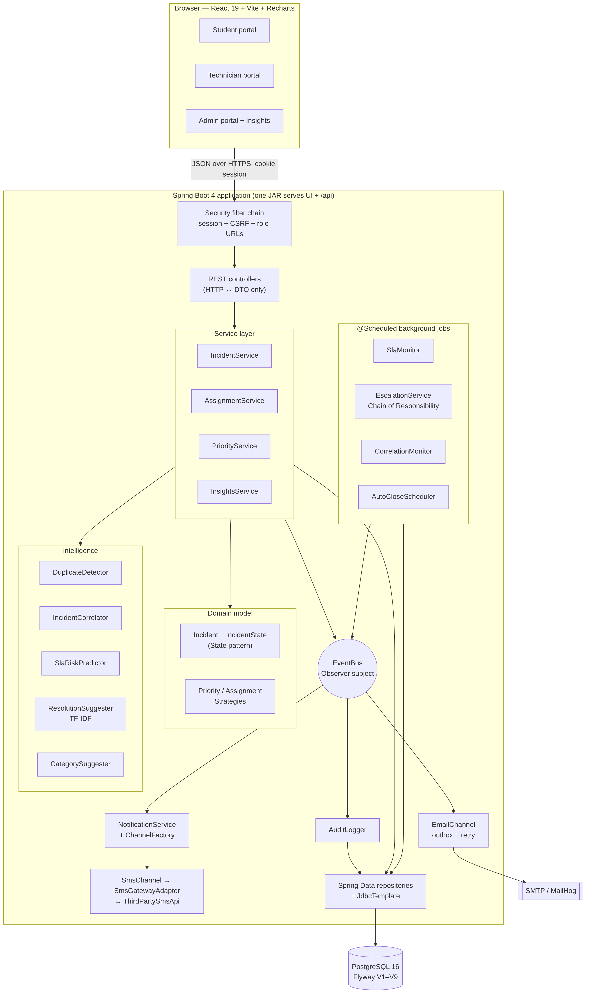
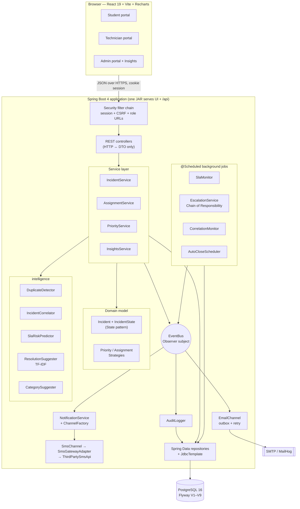

# System architecture

## Layers and responsibilities
| Layer | Package(s) | Rule |
|---|---|---|
| Presentation | `frontend/src` | Role-specific navigation; no business rules; friendly errors |
| API | `*Controller`, `api/`, `exception/GlobalApiErrors`, `incident/IncidentApiErrors` | Maps HTTP ↔ DTO records; **no business logic**; entities never returned directly (`IncidentData.View` etc.) |
| Service | `incident/IncidentService`, `assignment/AssignmentService`, `priority/PriorityService`, `api/InsightsService` | Transactions, role + ownership checks, orchestration |
| Domain | `incident/` (+ `state/`), `user/`, `assignment/*Strategy`, `priority/*Strategy`, `escalation/` | Invariants, state machine, algorithms. Plain Java, unit-testable |
| Intelligence | `intelligence/` | Pure algorithms behind `SimilarityModel` and plain classes |
| Events | `event/`, `audit/`, `notification/` | Observer: audit, notifications, e-mail, SMS |
| Persistence | `*Repository`, `sla/ScheduledEvents`, Flyway | JPA + pessimistic locks; SQL only where idempotency needs `on conflict` |

## Key interactions
1. **Request path**: Browser → security filter (session, CSRF, URL role) → controller → service (role + ownership) → domain method (state check) → repository → commit. Events are published inside the transaction, so audit/notification rows commit atomically with the change.
2. **Background path**: `SlaMonitor`, `CorrelationMonitor`, `AutoCloseScheduler` read immutable `IncidentSnapshot`s and claim each event key in `scheduled_events` before publishing, so restarts never repeat alerts.
3. **E-mail**: `EmailChannel` queues reporter e-mails in the same transaction; a separate worker sends committed rows with bounded retries.
