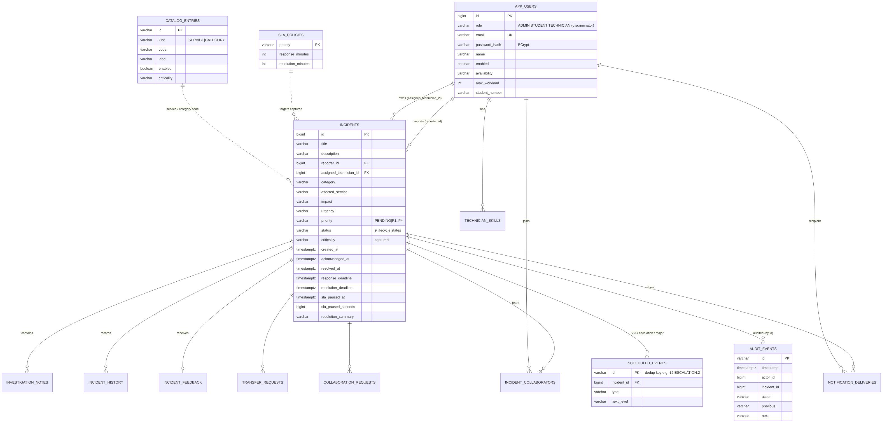
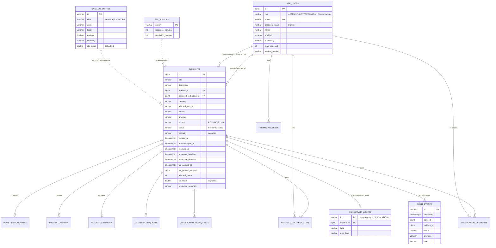

# Database design

PostgreSQL 16. The schema is owned by **Flyway** (`backend/src/main/resources/db/migration/V1…V8`); Hibernate only validates it (`ddl-auto=validate`).

## Tables
| Table | Purpose |
|---|---|
| `app_users` | Single-table inheritance for Student / Technician / Administrator (`role` discriminator) |
| `technician_skills` | Element collection of skills per technician (unique pair) |
| `catalog_entries` | Admin-editable services and categories (label, enabled, criticality, SLA factor ×0.25–×4) |
| `incidents` | Aggregate root: lifecycle, priority, affected users, captured SLA (+ service factor), pause bookkeeping, resolution |
| `investigation_notes` | Notes, information requests and student replies (visibility INTERNAL / STUDENT_VISIBLE) |
| `incident_history` | Per-incident timeline shown in the UI |
| `incident_feedback` | One 1–5 rating per incident (`check rating between 1 and 5`) |
| `incident_collaborators` | Approved collaborators |
| `transfer_requests`, `collaboration_requests` | Approval workflows (partial unique index: one pending transfer per incident) |
| `sla_policies` | Response/resolution minutes per priority (seeded P1 5/30 … P4 240/1440) |
| `priority_settings`, `assignment_settings` | Single-row runtime strategy configuration (JSONB thresholds/matrix/rules) |
| `scheduled_events` | Idempotency keys for SLA warnings, breaches, escalations, major incidents |
| `audit_events` | Immutable audit log (`updatable = false` columns) |
| `notification_deliveries` | In-app notifications and the e-mail outbox (status, attempts, next attempt) |

## Key relationships and constraints
* `incidents.reporter_id → app_users` (association); notes/history/feedback/collaborators cascade from the incident (composition).
* Check constraints mirror the Java enums (status, priority, levels, strategies); V8 extends them for `AWAITING_INFO` and the new strategies; V7 (automatic classification) makes service/category/impact/urgency nullable until classified; V9 adds affected users and the service SLA factor.
* Indexes: `(assigned_technician_id, status)` for workload, `(affected_service, status)` for duplicates/correlation, `(status, updated_at)` for auto-close.

## Sample data
With `SPRING_PROFILES_ACTIVE=dev`, `BITSOLVE_DEMO_SEED_ENABLED=true` and `DEMO_USER_PASSWORD` set, the application creates 4 students, 4 technicians (Hardware, Software, Database, Network) and 1 administrator, and, **only if the incidents table is empty**, 60 incidents over the last 30 days (54 resolved with resolution steps, history and feedback; 6 open). Verified against PostgreSQL 16: 331 history rows, 54 feedback rows (average 4.2).

| id | title | service | priority | status |
|---|---|---|---|---|
| 1 | Wi-Fi drops in hostel | CAMPUS_WIFI | P2 | VERIFIED |
| 4 | Student portal login fails | STUDENT_PORTAL | P1 | CLOSED |
| 7 | Lab PC does not boot | LAB_COMPUTERS | P4 | CLOSED |
| 14 | Network outage in academic block | CAMPUS_NETWORK | P1 | CLOSED |
| 60 | Moodle quiz page crashes | STUDENT_PORTAL | P1 | ASSIGNED |
