# 1. Problem Analysis

### Problem
When a campus IT service fails (Wi-Fi in a hostel block, the ERP student portal during registration, a lab licence server), students today report it through e-mails, phone calls and WhatsApp messages to individual staff. Reports are lost or duplicated, nobody knows who owns an issue, urgent problems wait behind trivial ones, there is no record of how long anything took, and the same fix is rediscovered again and again.

### Stakeholders
| Stakeholder | Interest |
|---|---|
| Students (reporters) | Report quickly, know the status, get it fixed, confirm the fix |
| Technicians | A clear, fair queue; context to investigate; past fixes; ability to ask the reporter |
| Administrators / IT manager (CCIT) | Prioritise by business impact, assign sensibly, meet SLAs, see trends, audit decisions |
| Maintenance Division / CCIT leadership | Service-level evidence, workload balance, recurring-problem detection |
| Course evaluators | Clean object-oriented design and working MVP |

### Existing challenges
1. **No single intake**: duplicates and lost reports.
2. **No prioritisation**: first-come-first-served regardless of impact.
3. **Ad-hoc assignment**: overload of the most visible technicians, skills mismatches.
4. **No SLA tracking or escalation**: critical outages can sit unacknowledged.
5. **No accountability**: who changed what, when, is not recorded.
6. **No knowledge reuse**: resolutions live in people's heads.
7. **No visibility**: no data on volume, trends or service health.

### Proposed solution
**BITSolve**, a web-based Intelligent IT Service Management system with three role-specific portals:
* A **controlled lifecycle** (State pattern) with SLA capture and a paused clock while waiting for the reporter.
* **Configurable prioritisation** (four runtime-switchable strategies) using impact, urgency and service criticality.
* **Assignment strategies** (skill, load, round-robin, priority/seniority, smart weighted recommendation) with audited fallback, plus transfer/collaboration approval workflows.
* **Background SLA monitoring**, warnings at 80 %, breaches, and a **Chain-of-Responsibility escalation** for unacknowledged P1s.
* **Event-driven notifications** (in-app, e-mail outbox, simulated SMS) and an **immutable audit trail** (Observer).
* **Intelligence**: auto-categorisation, duplicate detection, major-incident correlation, SLA-risk prediction, smart technician recommendation and suggested resolutions.
* **Analytics**: KPIs, trends, service analysis, workload, CSV/PDF export.

### Assumptions
* All users have institutional `@hyderabad.bits-pilani.ac.in` e-mail addresses. Students may self-register (student role only); technician and administrator accounts are created by an administrator.
* Administrators also perform the team-lead role (approvals, reassignment).
* One campus deployment; a single application instance with PostgreSQL is sufficient for the expected volume (hundreds of incidents per month).
* Students rate impact and urgency on a three-level scale; business criticality is owned by IT per service.
* SMS delivery is simulated (no paid gateway); e-mail goes to a real SMTP server or MailHog in the demo.
* Timestamps are stored in UTC and displayed in the browser's time zone; analytics days use Asia/Kolkata.

# 2. Requirements Specification

### User roles
| Role | Summary |
|---|---|
| **Student** (reporter) | Reports incidents, tracks own incidents, answers information requests, verifies or reopens resolutions, gives feedback |
| **Technician** | Works assigned incidents: acknowledge, investigate, notes, request info, resolve; requests transfer/collaboration; sees own workload, suggested resolutions and SLA risk |
| **Administrator / IT Manager** | Classifies, assigns, configures strategies, SLA policies, services, categories, users and technicians; approves transfers; insights, audit, closure |
| **System** (scheduler) | SLA monitoring, escalation, correlation, auto-close, notifications |

### Functional requirements
| ID | Requirement | Status |
|---|---|---|
| FR0 | Students self-register with institutional e-mail, student ID and a 12+ character password (can be disabled by configuration) | Done |
| FR1 | Users sign in with institutional e-mail + password; sessions expire after 30 min idle | Done |
| FR2 | Admin creates, edits, enables/disables users (Student/Technician/Admin) | Done |
| FR3 | Admin manages technician skills, availability and maximum workload | Done |
| FR4 | Admin manages IT services (label, enabled, business criticality) and incident categories | Done |
| FR5 | Student reports an incident (title, description, category, service, impact, urgency) | Done |
| FR6 | System suggests a category from the text and warns about possible duplicates | Done |
| FR7 | Admin classifies: system calculates priority with the active strategy and captures SLA deadlines | Done |
| FR8 | Admin selects priority strategy (4) and assignment strategy (5) at runtime | Done |
| FR9 | Incident assigned manually or automatically; fallback to another strategy is audited | Done |
| FR10 | Admin sees top-3 technician recommendations with explanations | Done |
| FR11 | Technician acknowledges, starts, adds internal/student-visible notes | Done |
| FR12 | Technician requests information → AWAITING_INFO, SLA paused; student replies → IN_PROGRESS | Done |
| FR13 | Technician records resolution summary and steps; sees 3 similar past resolutions | Done |
| FR14 | Student verifies or reopens; gives 1–5 feedback once | Done |
| FR15 | Admin closes verified incidents; system auto-closes after 72 h without response | Done |
| FR16 | Technician requests transfer/collaboration; admin approves/rejects; requester may cancel | Done |
| FR17 | SLA monitor issues warnings (80 %) and breaches, once each, persisted across restarts | Done |
| FR18 | Unacknowledged P1 escalates Technician → Team Lead → System Admin → IT Manager | Done |
| FR19 | ≥3 incidents on one service within 30 min are correlated into a major incident and admins alerted | Done |
| FR20 | Notifications for created, classified, priority change, assigned, acknowledged, info requested, resolved, closed, SLA warning/breach, escalation, duplicate, major incident | Done |
| FR21 | Channels: in-app (persisted, read state), e-mail (reporter lifecycle events, outbox with retry), SMS (simulated, urgent events) | Done |
| FR22 | Immutable audit trail of every action with actor, previous/new state; admin can filter | Done |
| FR23 | Search/filter by ID/keyword, status, category, priority, service, technician, date range, SLA status | Done (API: all 9; UI: main filters) |
| FR24 | Dashboards: overview KPIs, trend, per-service, category, workload, SLA compliance, MTTA/MTTR, feedback; role-specific home pages (admin live overview, technician "work on these first", student welcome) | Done |
| FR25 | Export incidents to CSV; print-to-PDF of the analytics page | Done |
| FR26 | SLA risk prediction per open incident (admin all; technician own) | Done |

### Non-functional requirements
| ID | Requirement |
|---|---|
| NFR1 Security | BCrypt, session rotation, CSRF, role + ownership checks, no secrets in code (SECURITY.md) |
| NFR2 Integrity | Pessimistic locks for lifecycle/capacity changes; DB constraints mirror domain enums; Flyway-versioned schema |
| NFR3 Reliability | Background events deduplicated in the DB; observer failures roll back; SMS failures never block work |
| NFR4 Performance | Typical API calls < 300 ms at campus scale (≤ 10k incidents); analytics computed on request |
| NFR5 Usability | Role-specific navigation; friendly error messages; one automatic retry for reads on network failure; mobile layout |
| NFR6 Maintainability | Layered architecture, SOLID, patterns documented; new strategy/channel/state = one class |
| NFR7 Testability | Pure domain/intelligence classes testable without Spring; ≥ 30 automated tests (≈ 222) |
| NFR8 Portability | Docker image; docker-compose for PostgreSQL + MailHog; environment-variable configuration |
| NFR9 Auditability | Every state change and configuration change audited with actor and timestamp |

### Business rules
1. Only the transitions in `uml/state.png` are permitted; each edge has permitted actors.
2. Priority is computed by the server; the client never supplies priority, criticality or deadlines.
3. A service without configured criticality cannot receive incidents.
4. SLA targets are captured at classification; later policy edits never change existing deadlines.
5. The resolution clock is paused in AWAITING_INFO; the deadline moves by the paused time.
6. A technician must be enabled, AVAILABLE, have spare capacity and the mandatory skill for the category.
7. Only the primary technician may acknowledge, start, request info or resolve; collaborators may add notes.
8. Feedback is allowed once, after verification, rating 1–5.
9. Warnings, breaches, escalations and major-incident alerts are sent at most once per incident and phase.
10. Notifications are never sent to the user who caused the event.
11. RESOLVED/VERIFIED incidents with no activity for 72 h are verified/closed by the system.

# 3. System Architecture

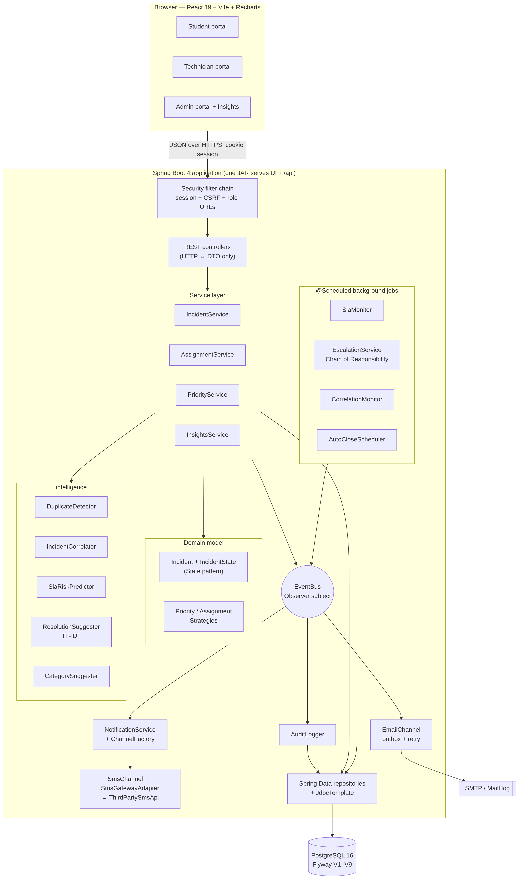

### Layers and responsibilities
| Layer | Package(s) | Rule |
|---|---|---|
| Presentation | `frontend/src` | Role-specific navigation; no business rules; friendly errors |
| API | `*Controller`, `api/`, `exception/GlobalApiErrors`, `incident/IncidentApiErrors` | Maps HTTP ↔ DTO records; **no business logic**; entities never returned directly (`IncidentData.View` etc.) |
| Service | `incident/IncidentService`, `assignment/AssignmentService`, `priority/PriorityService`, `api/InsightsService` | Transactions, role + ownership checks, orchestration |
| Domain | `incident/` (+ `state/`), `user/`, `assignment/*Strategy`, `priority/*Strategy`, `escalation/` | Invariants, state machine, algorithms. Plain Java, unit-testable |
| Intelligence | `intelligence/` | Pure algorithms behind `SimilarityModel` and plain classes |
| Events | `event/`, `audit/`, `notification/` | Observer: audit, notifications, e-mail, SMS |
| Persistence | `*Repository`, `sla/ScheduledEvents`, Flyway | JPA + pessimistic locks; SQL only where idempotency needs `on conflict` |

### Key interactions
1. **Request path**: Browser → security filter (session, CSRF, URL role) → controller → service (role + ownership) → domain method (state check) → repository → commit. Events are published inside the transaction, so audit/notification rows commit atomically with the change.
2. **Background path**: `SlaMonitor`, `CorrelationMonitor`, `AutoCloseScheduler` read immutable `IncidentSnapshot`s and claim each event key in `scheduled_events` before publishing, so restarts never repeat alerts.
3. **E-mail**: `EmailChannel` queues reporter e-mails in the same transaction; a separate worker sends committed rows with bounded retries.

### Running application (screenshots rendered with sample data)

Each role has its own colour, badge, menu and home page (brief: "difference in GUI for different users").

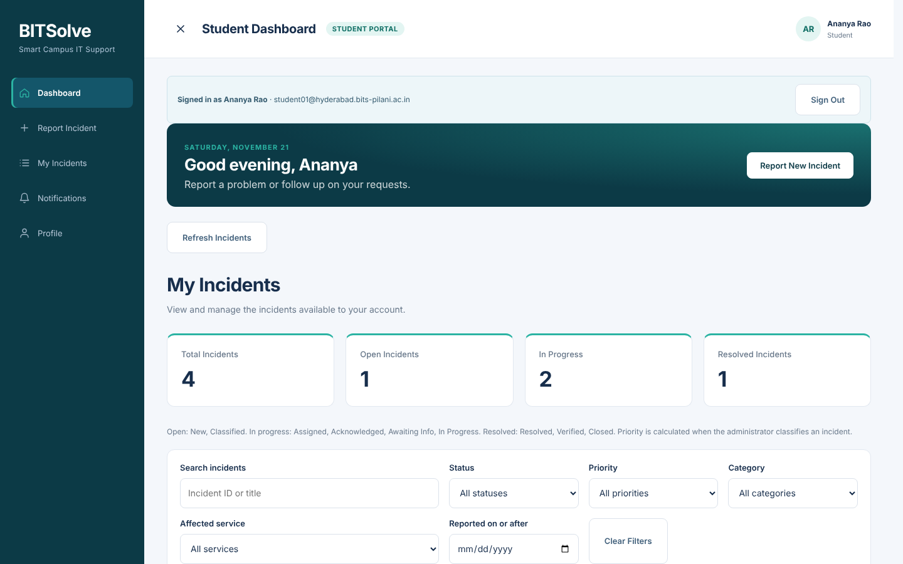

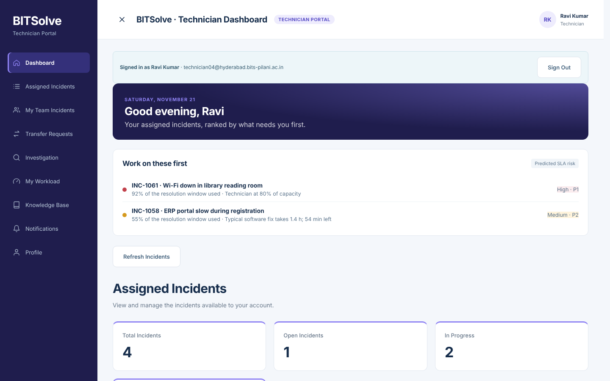

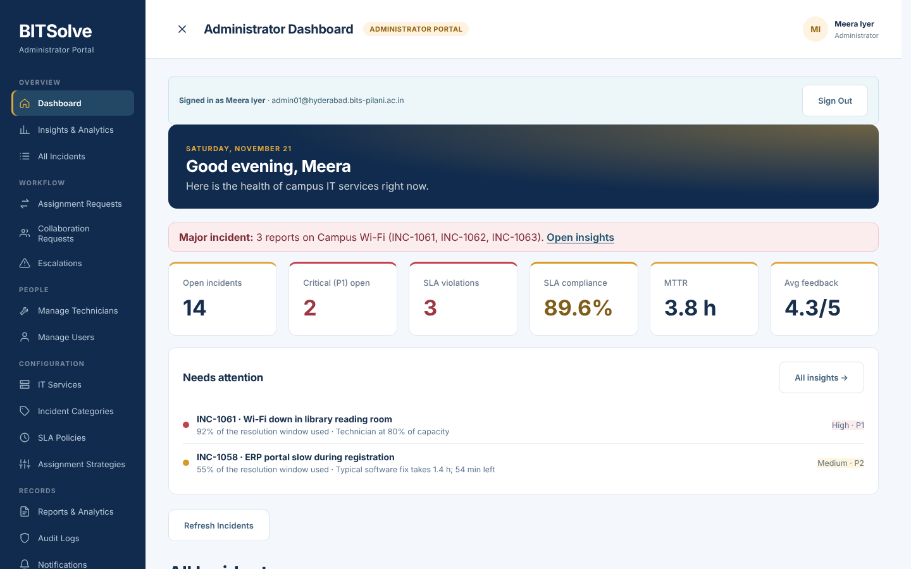

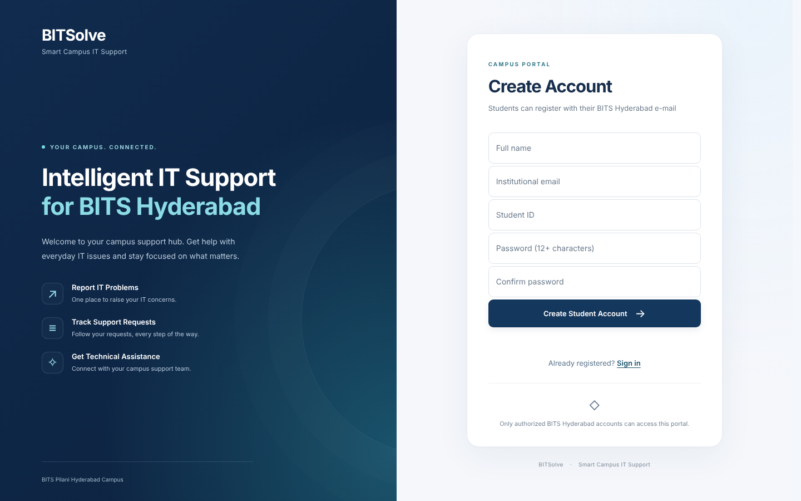

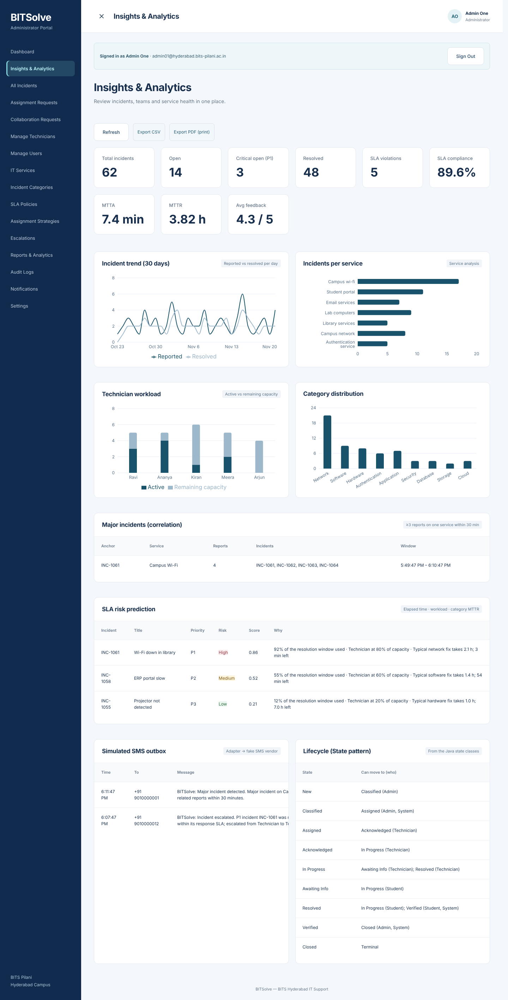

# 4. UML Diagrams

The PlantUML sources are in `docs/uml/*.puml`.

### Use case diagram
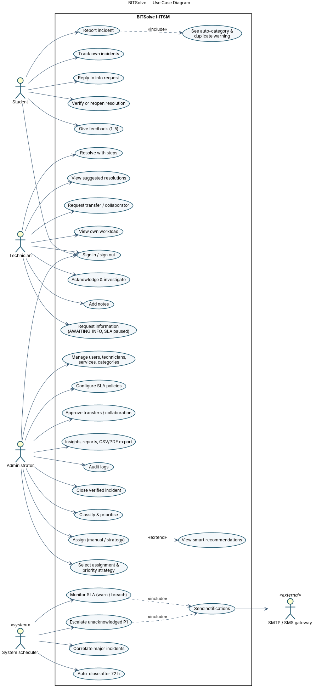

### Class diagram: domain model
Shows classes, attributes, methods, inheritance (User hierarchy, AssignmentRequest), association (reporter, technician), composition (notes, history, feedback, collaborators) and aggregation (audit entries).

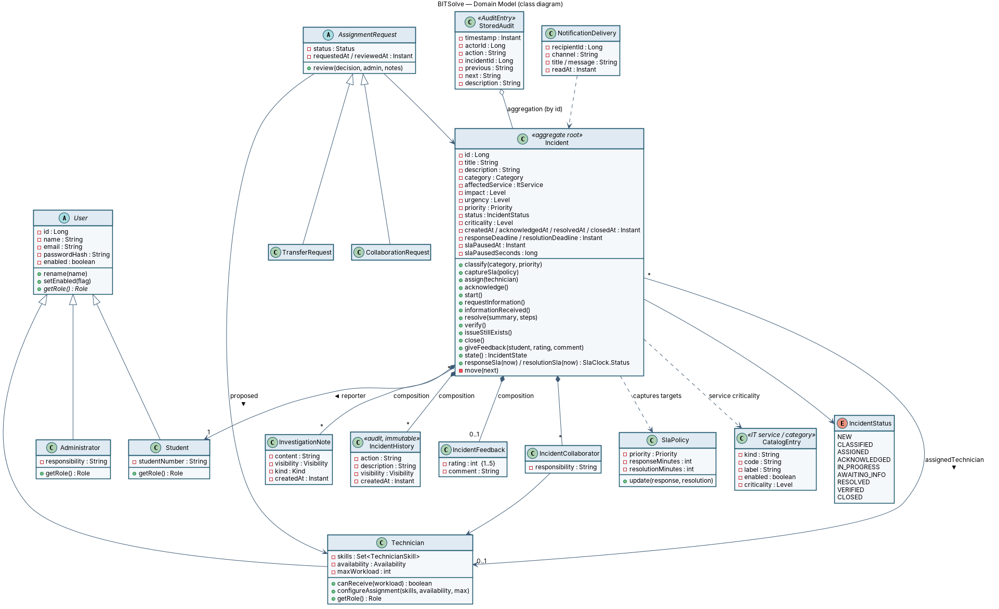

### Class diagram: design patterns (1/2): State, Chain of Responsibility, exceptions
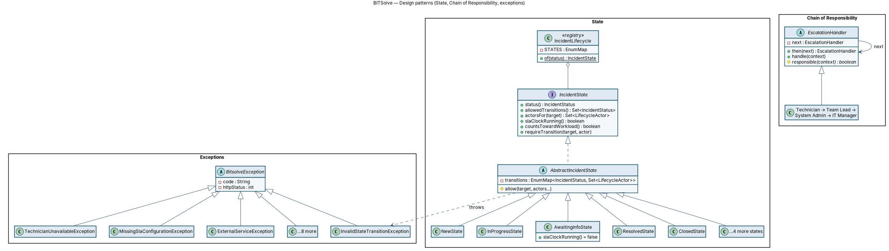

### Class diagram: design patterns (2/2): Strategy, Observer, Factory, Adapter
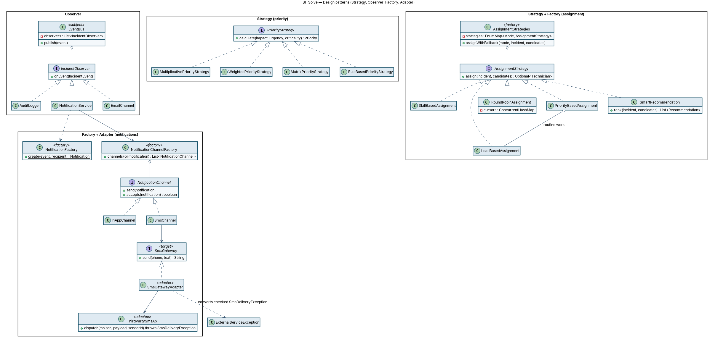

### State diagram: incident lifecycle
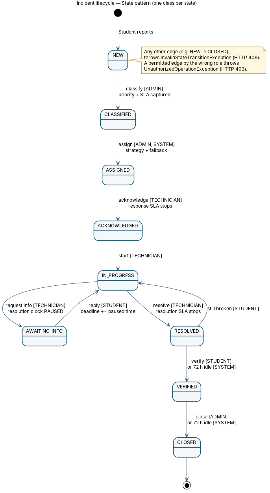

### Sequence diagrams: the three demo workflows
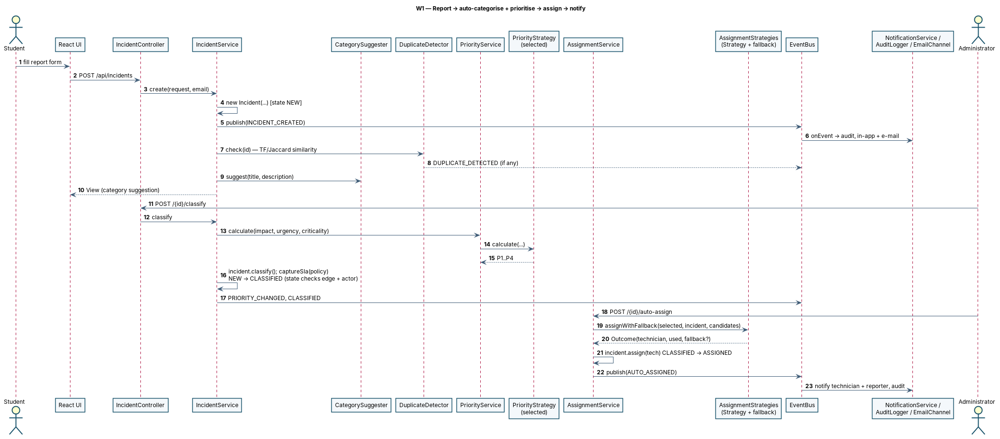

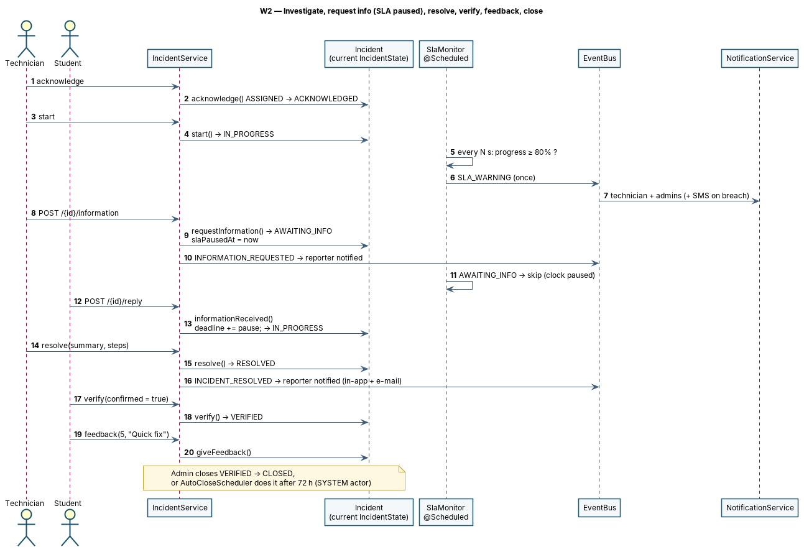

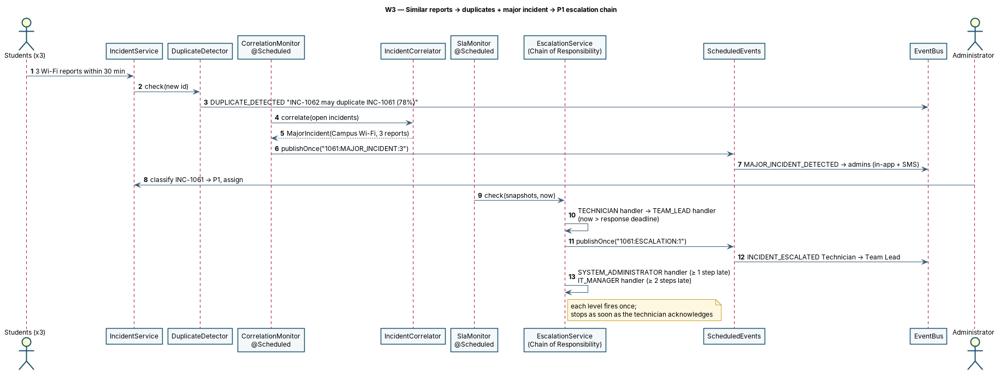

# 5. Technology Stack

| Layer | Technology | Version | Used for |
|---|---|---|---|
| Language | Java | 25 (runs on 17+) | Backend, domain model |
| Framework | Spring Boot | 4.1.2 | Web MVC, Data JPA, Security, Validation, Mail, Scheduling |
| ORM | Hibernate (via Spring Data JPA) | 7.x | Entities, repositories, pessimistic locks |
| Database | PostgreSQL | 16+ (tested 16 and 18) | Persistent store, JSONB for strategy settings |
| Migrations | Flyway | 11.x | Versioned schema V1–V7 |
| Security | Spring Security, BCrypt | 7.x | Sessions, CSRF, role URLs |
| Mail | Spring Mail / Jakarta Mail | – | Reporter e-mail outbox (Gmail SMTP or MailHog) |
| SMS | Simulated vendor via Adapter | – | Urgent alerts (no external cost) |
| Frontend | React | 19 | Role-specific portals |
| Build tool (UI) | Vite | 8 | Dev server, production bundle served by Spring |
| Charts | Recharts | 3.2 | Insights & Analytics dashboards |
| Tests | JUnit 5, Mockito, Spring Boot Test (MockMvc), Spring Security Test, node:test | – | Unit, integration, API-client tests |
| Coverage | JaCoCo (Maven profile `coverage`) | 0.8.14 | Coverage report |
| Diagrams | PlantUML, Mermaid | – | UML and architecture docs |
| Packaging | Docker (multi-stage), docker-compose | – | Image; PostgreSQL + MailHog + app |
| CI | GitHub Actions | – | Build + test on push |
| Hosting | Railway (Dockerfile) | – | Cloud deployment |

### The nine questions

**1. Why this language? (Java)** It is the course language, and its type system expresses the OOP concepts the project is graded on: abstract classes, interfaces, sealed enums, records for immutable DTOs and events, and checked/unchecked exceptions. Java also has the most mature enterprise ecosystem for transactions, ORM and security.

**2. Why this frontend? (React + Vite)** A component model fits three role-specific portals that share incident views (`MyIncidents`, `IncidentManagementActions`). Vite gives instant dev reloads and a small production bundle that Spring serves from the same origin. Recharts adds declarative SVG charts.

**3. Why this backend? (Spring Boot)** Dependency injection makes the patterns natural: every `IncidentObserver` and `NotificationChannel` bean is injected automatically. Spring also supplies declarative transactions, `@Scheduled` jobs for SLA monitoring, Bean Validation, Spring Security's session/CSRF protection, and MockMvc for integration tests.

**4. Why this database? (PostgreSQL)** Incidents, users and assignments are highly relational and need integrity: foreign keys, check constraints mirroring enums, partial unique indexes ("one pending transfer per incident"), and row locks (`SELECT … FOR UPDATE`) for capacity checks. JSONB stores the flexible strategy configuration. `INSERT … ON CONFLICT DO NOTHING` provides exactly-once background events. Firebase or another document store would make these guarantees much harder.

**5. Why this architecture? (layered monolith + event bus)** For one campus and a five-person team, a layered monolith is simple to build, test and deploy. Layers (controller → service → domain → repository) keep responsibilities separate. The internal EventBus gives event-driven decoupling (audit, notifications, SMS) without operating a message broker.

**6. Alternatives considered**
| Choice | Alternative | Why not (now) |
|---|---|---|
| Spring Boot | Jakarta EE / Quarkus / Node.js | Less course familiarity; Node lacks the OOP emphasis |
| PostgreSQL | MySQL, MongoDB, Firebase | Weaker check/partial-index support (MySQL); no relational integrity (Mongo/Firebase) |
| Sessions + CSRF | JWT | Revocation and safe token storage are harder for a browser-only client (SECURITY.md) |
| React | Angular, Thymeleaf | Angular is heavier for this size; server templates give a weaker interactive UX |
| In-process EventBus | Kafka / RabbitMQ | Operational overhead not justified at campus scale (see Q9) |
| Rule-based intelligence | Paid LLM APIs | Cost, privacy of student data, non-determinism in a graded demo |

**7. Advantages and limitations**
* *Advantages:* strong consistency and auditability; patterns make features pluggable; one deployable; all intelligence explainable and testable offline; low cost.
* *Limitations:* single instance (in-memory round-robin cursor and SMS history); analytics computed on request; no mobile push; SMS simulated; no login rate limiting; the UI is JavaScript rather than TypeScript.

**8. How the stack supports object-oriented design** JPA maps the class hierarchy (`User` → subclasses, single-table inheritance) and composition (cascade on notes/history/feedback) directly. Spring's DI injects interfaces (`List<IncidentObserver>`, `List<NotificationChannel>`, `SmsGateway`), so the code depends on abstractions (Dependency Inversion). Strategy, State and Chain objects stay plain Java and are unit-testable without Spring. Records give immutable value objects (`IncidentEvent`, `IncidentSnapshot`, DTOs).

**9. Evolution at much larger scale (e.g. all BITS campuses)**
* **Horizontal scaling:** run several stateless app instances behind a load balancer; move sessions to Spring Session + Redis; move the round-robin cursor and SMS history to Redis; elect one scheduler leader (ShedLock), with `scheduled_events` already guaranteeing exactly-once alerts.
* **Caching:** cache catalog, SLA policies and strategy settings (Caffeine/Redis, evicted on admin change); materialise daily analytics.
* **Message queue:** replace the in-process EventBus with Kafka/RabbitMQ topics (`incident-events`). Audit, notifications, e-mail and SMS become independent consumers with retries and dead-letter queues; use the transactional outbox pattern (the e-mail outbox already works this way).
* **Microservice split** along the existing packages: Identity, Incident (lifecycle + SLA), Assignment, Notification, Analytics/Intelligence (read model fed by events), each with its own schema.
* **Search and ML:** OpenSearch for full-text search; replace `SimilarityModel` with sentence embeddings and a vector index; train the SLA-risk model on the accumulated history.
* **Database:** read replicas for analytics, partition `audit_events` and `notification_deliveries` by month.

# 6. Database Design

PostgreSQL 16. The schema is owned by **Flyway** (`backend/src/main/resources/db/migration/V1…V7`); Hibernate only validates it (`ddl-auto=validate`).

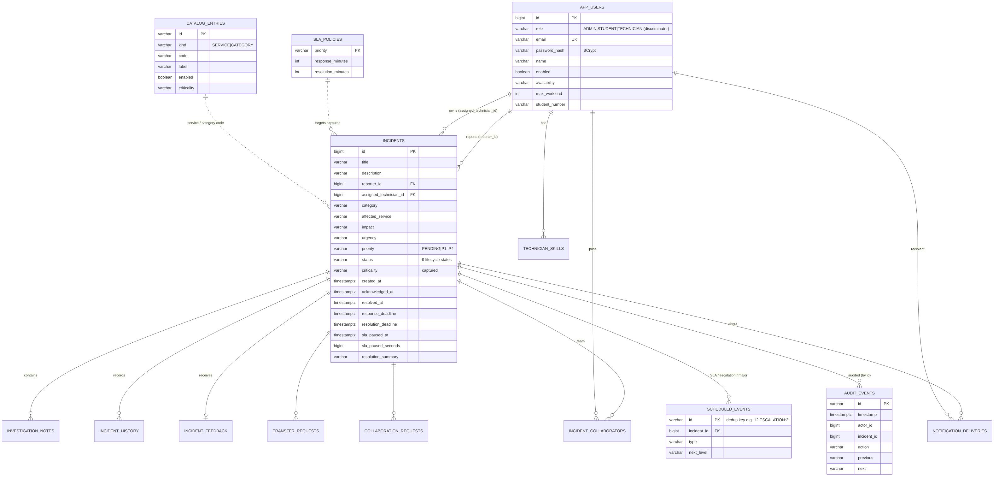

### Tables
| Table | Purpose |
|---|---|
| `app_users` | Single-table inheritance for Student / Technician / Administrator (`role` discriminator) |
| `technician_skills` | Element collection of skills per technician (unique pair) |
| `catalog_entries` | Admin-editable services and categories (label, enabled, criticality) |
| `incidents` | Aggregate root: lifecycle, priority, captured SLA, pause bookkeeping, resolution |
| `investigation_notes` | Notes, information requests and student replies (visibility INTERNAL / STUDENT_VISIBLE) |
| `incident_history` | Per-incident timeline shown in the UI |
| `incident_feedback` | One 1–5 rating per incident (`check rating between 1 and 5`) |
| `incident_collaborators` | Approved collaborators |
| `transfer_requests`, `collaboration_requests` | Approval workflows (partial unique index: one pending transfer per incident) |
| `sla_policies` | Response/resolution minutes per priority (seeded P1 5/30 … P4 240/1440) |
| `priority_settings`, `assignment_settings` | Single-row runtime strategy configuration (JSONB thresholds/matrix/rules) |
| `scheduled_events` | Idempotency keys for SLA warnings, breaches, escalations, major incidents |
| `audit_events` | Immutable audit log (`updatable = false` columns) |
| `notification_deliveries` | In-app notifications and the e-mail outbox (status, attempts, next attempt) |

### Key relationships and constraints
* `incidents.reporter_id → app_users` (association); notes/history/feedback/collaborators cascade from the incident (composition).
* Check constraints mirror the Java enums (status, priority, levels, strategies); V7 extends them for `AWAITING_INFO` and the new strategies.
* Indexes: `(assigned_technician_id, status)` for workload, `(affected_service, status)` for duplicates/correlation, `(status, updated_at)` for auto-close.

### Sample data
With `SPRING_PROFILES_ACTIVE=dev`, `BITSOLVE_DEMO_SEED_ENABLED=true` and `DEMO_USER_PASSWORD` set, the application creates 4 students, 4 technicians (Hardware, Software, Database, Network) and 1 administrator, and, **only if the incidents table is empty**, 60 incidents over the last 30 days (54 resolved with resolution steps, history and feedback; 6 open). Verified against PostgreSQL 16: 331 history rows, 54 feedback rows (average 4.2).

| id | title | service | priority | status |
|---|---|---|---|---|
| 1 | Wi-Fi drops in hostel | CAMPUS_WIFI | P2 | VERIFIED |
| 4 | Student portal login fails | STUDENT_PORTAL | P1 | CLOSED |
| 7 | Lab PC does not boot | LAB_COMPUTERS | P4 | CLOSED |
| 14 | Network outage in academic block | CAMPUS_NETWORK | P1 | CLOSED |
| 60 | Moodle quiz page crashes | STUDENT_PORTAL | P1 | ASSIGNED |

# 7. Design Patterns and OOP Concepts

Seven Gang-of-Four / enterprise patterns are implemented in production code (not just tests). Each entry gives the problem, the participating classes, where the code lives and why the pattern was chosen. Diagrams: `uml/class-patterns-1.png`, `uml/class-patterns-2.png`, `uml/state.png`.

Paths are relative to `backend/src/main/java/com/bits/itsm/`.

### 1. State: incident lifecycle

| | |
|---|---|
| **Problem** | An incident moves through nine states. Each state allows different next states, different actors, and behaves differently (SLA clock running, counting toward workload). Spreading `if (status == …)` checks across services is fragile and lets illegal jumps such as NEW → CLOSED slip through. |
| **Participants** | `IncidentState` (interface), `AbstractIncidentState` (shared table logic), nine concrete states (`NewState` … `ClosedState`, including `AwaitingInfoState`), `IncidentLifecycle` (registry/flyweight), context = `Incident` |
| **Code** | `incident/state/*`, `incident/Incident.java#move` |
| **How it works** | `Incident.move(next)` calls `state().requireTransition(next)`. Each state declares its edges and permitted actors in its constructor with `allow(target, actors…)`, stored in an `EnumMap`. Illegal edges throw `InvalidStateTransitionException` (409). Legal edges by the wrong actor throw `UnauthorizedOperationException` (403). `AwaitingInfoState.slaClockRunning()` returns false, which is how the SLA pause is expressed. |
| **Why** | Each state's rules are in one small class, the transition table is testable exhaustively (`IncidentStateMachineTest` checks all 81 from/to pairs), and the `/api/incidents/lifecycle` endpoint and UI table are generated from the same objects, so documentation cannot drift from code. |

### 2. Strategy: priority calculation

| | |
|---|---|
| **Problem** | Campus IT wants to experiment with different prioritisation policies without redeploying. |
| **Participants** | `PriorityStrategy` + `MultiplicativePriorityStrategy`, `WeightedPriorityStrategy`, `MatrixPriorityStrategy`, `RuleBasedPriorityStrategy`; context `PriorityService` |
| **Code** | `priority/*` |
| **Why** | The admin switches strategy at runtime (persisted in `priority_settings`). Existing incidents keep their captured priority. See `PRIORITY_ALGORITHM.md`. |

### 3. Strategy + Factory: technician assignment

| | |
|---|---|
| **Problem** | Different assignment policies (skills, load, fairness, seniority, weighted ranking) must be switchable at runtime with no redesign, and a failure of one policy must not leave the incident unassigned if another could succeed. |
| **Participants** | `AssignmentStrategy` + `SkillBasedAssignment`, `LoadBasedAssignment`, `RoundRobinAssignment`, `PriorityBasedAssignment`, `SmartRecommendation`; factory/registry `AssignmentStrategies` (`EnumMap<Mode, AssignmentStrategy>`); context `AssignmentService` |
| **Code** | `assignment/*` |
| **How it works** | `AssignmentStrategies.assignWithFallback(selected, …)` runs the selected strategy, then the others in a fixed order, and returns an `Outcome(technician, used, fallback)`. A fallback is written to the incident history as `ASSIGNMENT_FALLBACK`. Every strategy goes through `Candidate.eligible()`, so none can bypass a mandatory skill, availability or capacity. |
| **Why** | Open/Closed: a sixth strategy is one new class plus one enum constant. Strategy objects are created once so stateful ones (round-robin cursors) keep state. `PriorityBasedAssignment` uses composition: it delegates routine work to a `LoadBasedAssignment` it holds. |

### 4. Observer: notifications and audit

| | |
|---|---|
| **Problem** | Many things must happen when an incident changes (audit, in-app notification, e-mail, SMS) and the business services should not know about any of them. |
| **Participants** | Subject `EventBus`; observer interface `IncidentObserver`; observers `AuditLogger`, `NotificationService`, `EmailChannel`; event `IncidentEvent` (immutable record); helper `IncidentEventPublisher` |
| **Code** | `event/*`, `audit/AuditLogger.java`, `notification/*` |
| **Why** | Hand-written rather than Spring events so the pattern is visible. Spring injects every `IncidentObserver` bean into `EventBus`, so a new observer needs no change elsewhere. Observers run inside the business transaction: if auditing fails, the change rolls back, so there is never an un-audited change. |

### 5. Factory: users, notifications, channels

* **`NotificationFactory.create(event, recipient)`** builds the right title and wording per `EventType`.
* **`NotificationChannelFactory.channelsFor(notification)`** returns the channels whose `accepts()` preference matches. For example, SMS is used only for SLA breaches, escalations and major incidents (configurable `itsm.sms.events`).
* **`UserFactory.create(role, …)`** is the single place that instantiates `Student`, `Technician` or `Administrator`; both admin account creation and student self-registration use it. Clients cannot set a role directly (`User.getRole()` is abstract).

### 6. Adapter: SMS gateway (and the persistence snapshot)

| | |
|---|---|
| **Problem** | A third-party SMS SDK has its own method names, number format, response object and a checked exception. |
| **Participants** | Target `SmsGateway`; Adapter `SmsGatewayAdapter`; Adaptee `ThirdPartySmsApi` (simulated vendor; logs instead of sending); client `SmsChannel` |
| **Code** | `notification/sms/*` |
| **How it works** | The adapter converts "+91 90123 45678" to MSISDN "919012345678", truncates to one 160-character segment, adds the sender id, and translates the checked `SmsDeliveryException` into the unchecked `ExternalServiceException`. |
| **Why** | Changing SMS vendor (Twilio, MSG91) means writing one new adapter. A second adapter, `RepositoryIncidentLookup`, adapts JPA entities to immutable `IncidentSnapshot`s for the SLA and intelligence code. |

### 7. Chain of Responsibility: automatic escalation

| | |
|---|---|
| **Problem** | An unacknowledged P1 must climb Technician → Team Lead → System Administrator → IT Manager, each level with its own timer, without one long if/else. |
| **Participants** | `EscalationHandler` (abstract handler with `next`), the levels built by `EscalationHandler.technician()` and `EscalationHandler.timed(level, delay)`, client `EscalationService` |
| **Code** | `escalation/*` |
| **How it works** | `handle()` asks the handler whether its timer has expired. If not, the chain stops. If so, it escalates (persisted once via `ScheduledEvents.publishOnce`) and passes the request on. Team Lead fires at the response deadline, System Administrator one step later, IT Manager two steps later. |
| **Why** | Adding a level (e.g. Dean of Student Welfare) is one more link. Each escalation is idempotent across restarts. |

### 8. Repository

Spring Data JPA interfaces (`IncidentRepository`, `UserRepository`, `SlaPolicyRepository` …) hide SQL behind collection-like methods, including a pessimistic-lock finder (`findForUpdate`) that serialises concurrent lifecycle actions on one incident.

### OOP concepts: where to point the examiner

| Concept | Where |
|---|---|
| Encapsulation | `Incident`: private fields, no status/priority/deadline setters, invariants enforced in `classify`, `captureSla`, `resolve` (text length), `giveFeedback` (1–5, once). `Technician.configureAssignment` validates skills and capacity. |
| Abstraction | `User` (abstract `getRole()`), `IncidentState`, `AssignmentStrategy`, `SimilarityModel`, `BitsolveException` |
| Inheritance (is-a only) | `User` → `Student` / `Technician` / `Administrator`; `AbstractIncidentState` → 9 states; `AssignmentRequest` → `TransferRequest` / `CollaborationRequest`; `BitsolveException` → 12 subclasses |
| Polymorphism | `state().requireTransition()`, `strategy.assign()`, `observer.onEvent()`, `channel.accepts()`, one `@ExceptionHandler` for every `BitsolveException` through `code()` / `httpStatus()` |
| Interfaces | 10+ (see the class diagrams) |
| Composition | `Incident` owns notes, history, feedback, collaborators (cascade persist, no independent life); `PriorityBasedAssignment` contains a `LoadBasedAssignment` |
| Association | `Incident` → reporter `Student`, → assigned `Technician` |
| Aggregation | Audit entries reference incidents by id and outlive them; `EventBus` aggregates observers |
| Exception handling | Custom hierarchy (`exception/`), checked `SmsDeliveryException` at the external boundary, `GlobalApiErrors` / `IncidentApiErrors` produce `{timestamp, status, code, message, path}`. See the table below. |

### Exception handling: the brief's twelve situations

| Brief situation | Exception (HTTP) | Thrown where |
|---|---|---|
| Invalid login | `InvalidLoginException` (401) | `AuthController` on any authentication failure (same message for wrong, unknown, disabled) |
| Unauthorized operation | `UnauthorizedOperationException` (403) | State transition by the wrong role; insights for the wrong role; registration disabled |
| Invalid incident | `InvalidIncidentException` (400) | `Incident` title/description/resolution length rules |
| Invalid state transition | `InvalidStateTransitionException` (409) | Every `Incident` status change via `IncidentState` |
| Technician unavailable | `TechnicianUnavailableException` (409) | `Incident.assign/reassign`; automatic assignment finds nobody |
| Workload exceeded | `WorkloadExceededException` (409) | Manual assignment / transfer to a technician at capacity |
| Service not found | `ServiceNotFoundException` (404) | `CatalogService.get` for an unknown IT service |
| Missing SLA configuration | `MissingSlaConfigurationException` (409) | `SlaPolicies.capture` at classification |
| Duplicate incident | `DuplicateIncidentException` (409) | Same report resubmitted (idempotency key); similar reports raise a *warning* event instead |
| Database failure | `PersistenceException` (500, generic message) | `GlobalApiErrors` wraps any Spring `DataAccessException` |
| Network failure | `ExternalServiceException` (502) + frontend retry | SMS adapter; `api.js` retries reads once and shows a friendly message |
| Invalid user input | `ValidationException` (400) + Bean Validation | Search dates, registration rules, DTO constraints |
| Collections | `EnumMap` (state transition tables, strategy registry, per-service correlation), `EnumSet` (actors per edge, SMS event preferences), `ConcurrentHashMap` + `AtomicInteger` (round-robin cursors), `ConcurrentLinkedDeque` (bounded SMS history), `LinkedHashMap` (30-day trend in calendar order, ordered recipients), `TreeMap` (sorted chart categories) |

# 8. Priority Algorithm

Priority is always calculated in Java (never trusted from the browser) when an administrator **classifies** a NEW incident. Inputs:

* **Impact** and **Urgency**: chosen by the student: LOW / MEDIUM / HIGH.
* **Business criticality**: read from the selected IT service's database record (LOW / MEDIUM / HIGH, set by an admin under *IT Services*). A service with no criticality configured cannot receive incidents.

The administrator picks one of four strategies at runtime (*Assignment Strategies → Priority Strategy*). The choice is persisted in `priority_settings`, audited as `PRIORITY_CONFIGURATION_CHANGED`, and applies to **future** classifications only: captured priorities and SLA deadlines never change retroactively. The resulting priority selects the SLA policy (`sla_policies`) whose targets are captured on the incident.

### 1. Multiplicative (default)

`score = impact × urgency × criticality`, with LOW/MEDIUM/HIGH = 1/2/3, so the score ranges from 1 to 27.

| Threshold (inclusive, admin-configurable) | Priority |
|---|---|
| score ≥ 18 | **P1 Critical** |
| 12 ≤ score < 18 | **P2 High** |
| 4 ≤ score < 12 | **P3 Medium** |
| score < 4 | **P4 Low** |

**Rationale.** Multiplication means one LOW factor pulls the score down sharply: a high-impact problem on a low-criticality service is not a P1. 18 is the smallest product that needs at least two HIGH factors and one MEDIUM (3·3·2).

| Example | I | U | C | Score | Priority |
|---|---|---|---|---|---|
| Campus Wi-Fi down for a hostel block | HIGH | HIGH | HIGH | 27 | P1 |
| Fee payment fails (portal criticality MEDIUM) | HIGH | HIGH | MEDIUM | 18 | P1 |
| Library e-journals unreachable | MEDIUM | MEDIUM | HIGH | 12 | P2 |
| One lab PC will not boot | HIGH | LOW | MEDIUM | 6 | P3 |
| Email signature formatting | LOW | LOW | MEDIUM | 2 | P4 |

### 2. Weighted

Levels are normalised to 0 / 0.5 / 1, then `score = 100 × (wᵢ·impact + wᵤ·urgency + w꜀·criticality)`. Default weights are 0.4 / 0.4 / 0.2 (must be non-negative and sum to 1). Thresholds: P1 ≥ 75, P2 ≥ 50, P3 ≥ 25, otherwise P4.

| I | U | C | Score | Priority |
|---|---|---|---|---|
| HIGH | HIGH | LOW | 100·(0.4+0.4+0) = 80 | P1 |
| MEDIUM | HIGH | MEDIUM | 100·(0.2+0.4+0.1) = 70 | P2 |
| LOW | MEDIUM | HIGH | 100·(0+0.2+0.2) = 40 | P3 |
| LOW | LOW | MEDIUM | 100·(0.1) = 10 | P4 |

### 3. Priority matrix

A 3×3 table (rows = impact, columns = urgency, default below). A HIGH-criticality service promotes the result by `critical_boost` levels (default 1, range 0–3), capped at P1.

| Impact \ Urgency | LOW | MEDIUM | HIGH |
|---|---|---|---|
| **LOW** | P4 | P3 | P2 |
| **MEDIUM** | P3 | P2 | P1 |
| **HIGH** | P2 | P1 | P1 |

Example: MEDIUM/MEDIUM gives P2, and on a HIGH-criticality service it becomes **P1**.

### 4. Rule-based

An ordered list of predefined conditions; the first match wins, otherwise the fallback applies. Default:

1. `ALL_HIGH` → P1
2. `HIGH_IMPACT_AND_URGENCY` → P2
3. `CRITICAL_SERVICE` → P2
4. fallback → P3

Admins can reorder or remove rules (`HIGH_IMPACT`, `HIGH_URGENCY` are also available) and choose each result.

### SLA targets per priority (defaults, editable under *SLA Policies*)

| Priority | Response | Resolution |
|---|---|---|
| P1 | 5 min | 30 min |
| P2 | 15 min | 2 h |
| P3 | 1 h | 8 h |
| P4 | 4 h | 24 h |

If no policy exists for a priority, classification fails with `MissingSlaConfigurationException` (HTTP 409) and the incident stays NEW.

### Differences from the original prompt (see DECISIONS.md)

* Impact/urgency use three levels (LOW/MEDIUM/HIGH) instead of 1–4. Students found a 4-point scale hard to apply consistently, and three levels keep the matrix readable.
* There is no "affected users" multiplier, because the incident form does not collect a user count. The rule-based and matrix strategies cover "many people affected" through HIGH impact.
* "Security category + high impact ⇒ P1" and "Payment service down ⇒ P1" are expressed with the configurable rules (`HIGH_IMPACT_AND_URGENCY`, `CRITICAL_SERVICE`) together with service criticality, rather than hard-coded category names.

# 9. Security

| # | Threat | Mitigation in BITSolve | Where |
|---|---|---|---|
| S1 | Password theft from the database | BCrypt hashes only; `User` rejects non-BCrypt values; hash never serialised (`@JsonIgnore`) | `user/User.java`, `auth/` |
| S2 | Account enumeration | Wrong, unknown and disabled accounts get the identical generic error | `AuthService`, test `wrongUnknownAndDisabledAccountsReturnSameGenericError` |
| S3 | Session fixation | Session id **and** CSRF token rotated on login; session invalidated and cookie deleted on logout | `SecurityConfig.sessionAuthenticationStrategy`, test `rotatesSessionAndCsrfThenInvalidatesSessionOnLogout` |
| S4 | Cross-site request forgery | Server-side CSRF tokens required on every mutation (including login/logout); cookie `HttpOnly`, `SameSite=Lax`, `Secure` behind HTTPS | `SecurityConfig`, `api.js#apiSend` |
| S5 | Privilege escalation by URL | `/api/admin/**` = ADMIN, `/api/technician/**` = TECHNICIAN, `/api/student/**` = STUDENT, everything else authenticated | `SecurityConfig` |
| S6 | Privilege escalation inside shared endpoints | Every service method re-checks the role (`actor(email, Role…)`) **and ownership**: students see only their own incidents, technicians only incidents they own or collaborate on | `IncidentService.access`, `AssignmentService`, `InsightsService` |
| S7 | Illegal workflow manipulation | State pattern validates every edge **and the actor** for that edge (409 / 403); rolls back the transaction | `incident/state/*`, `IncidentService.finish` |
| S8 | Disabled user keeps working | Enabled flag checked on every request | `EnabledAccountFilter` |
| S9 | Injection | JPA/JPQL parameters and `JdbcTemplate` placeholders only; no string-built SQL with user input | repositories, `ScheduledEvents` |
| S10 | Mass assignment / forged fields | DTO records with Bean Validation (`@NotNull`, `@Size`, `@Min/@Max`); role, priority, criticality and deadlines are never accepted from the client | `IncidentData`, `AssignmentData` |
| S11 | Information leakage in errors | Consistent `{timestamp,status,code,message,path}`; 5xx messages replaced with a generic text; SMTP errors reduced to class names; private notes never e-mailed | `GlobalApiErrors`, `EmailChannel` |
| S12 | CSV/spreadsheet formula injection in exports | Cells starting `= + - @` are prefixed with `'` and all cells are quoted | `InsightsService.cell`, `CsvExportTest` |
| S13 | Secrets in source control | DB, SMTP and bootstrap credentials only via environment variables; demo seeding requires the `dev` profile **and** an explicit flag **and** a password variable | `application.properties`, `DemoUserSeeder` |
| S14 | Lost/duplicated background actions after restart | SLA warnings, breaches, escalations and major-incident alerts are claimed in `scheduled_events` with a unique key before publishing | `ScheduledEvents.publishOnce` |
| S16 | Abuse of self-registration | Only STUDENT accounts; institutional e-mail only; 12–72 byte passwords that may not contain the e-mail name; BCrypt; audited as `USER_REGISTERED`; can be disabled. Trade-off: "account already exists" reveals that an e-mail is registered (sign-up enumeration), which is acceptable for campus e-mail addresses that are public anyway | `RegistrationController` |
| S17 | Double submission / replay of a report | One-time `Idempotency-Key` per report form; reuse → `DuplicateIncidentException` | `IncidentService.create` |
| S15 | Notification spam by SMS | SMS restricted to urgent event types; delivery failures never roll back business actions | `SmsChannel` |

### Deliberate design choice: sessions instead of JWT

The original prompt suggested stateless JWT. The team chose **server-side sessions + CSRF** for a browser-only application served from the same origin. This removes token storage in `localStorage` (an XSS target), allows immediate revocation (disabled accounts lose access on their next request), and needs no refresh-token logic. JWT would be preferable for third-party/mobile API clients; see DECISIONS.md D1.

### Not implemented (known limitations)

* **Login rate limiting / lockout.** Brute force is slowed only by BCrypt cost. Recommended next step: a per-IP + per-account token bucket (e.g. Bucket4j) in front of `/api/auth/login`.
* **Multi-factor authentication.**
* **CORS configuration** is unnecessary because the React build is served by the same Spring Boot origin. A split-origin deployment would need an explicit allow-list.
* **HTTPS** is terminated by the hosting platform (Railway) and not by the application; `SESSION_COOKIE_SECURE=true` must be set there.
* **Security headers** beyond Spring Security defaults (CSP) are not tuned.
* **Real SMS delivery.** The SMS vendor is simulated (logs only).

# 10. Testing

**Automated suite:** the team's suite (165 backend tests, last full run 16 Nov 2026 on PostgreSQL) plus **57 new unit tests** added in the final stage (state machine, strategies, intelligence, SMS adapter, exports), giving about 222 automated tests. Run `./mvnw verify` for unit + MockMvc tests and `BITSOLVE_DB_TESTS=true ./mvnw verify` to add the PostgreSQL integration tests. Frontend: `npm test` (API client).

"Actual" column:
* **Pass**: re-run after the final changes (129 plain unit tests: 72 existing + 57 new).
* **Re-run before submission**: Spring context / MockMvc / PostgreSQL tests that passed in the team's 16 Nov run but need a fresh `./mvnw verify` on a machine with Maven access.

| ID | Description | Category | Preconditions | Input | Expected result | Actual | Automated test |
|---|---|---|---|---|---|---|---|
| TC01 | Full lifecycle NEW→…→CLOSED records timestamps | Normal | Classified network incident, available tech | classify, assign, ack, start, resolve, verify, close | Status CLOSED; ack/resolved/verified/closed times set | Pass | `IncidentWorkflowTests.completesOrderedLifecycleAndTimestamps` |
| TC02 | NEW → CLOSED is rejected | Business rule / exception | NEW incident | `close()` | `InvalidStateTransitionException`, status stays NEW | Pass | `IncidentStateMachineTest.newToClosedIsRejectedOnTheEntity` |
| TC03 | All 71 illegal edges rejected, 10 legal edges accepted | Business rule | – | every (from,to) pair | exactly the documented edges succeed; others → 409 code `INVALID_STATE_TRANSITION` | Pass | `IncidentStateMachineTest.everyEdgeNotInTheTableIsRejectedWithInvalidStateTransition` |
| TC04 | Each state allows only its actors | Authorization | – | 12 (from,to,actor) combinations | allowed / `UnauthorizedOperationException` | Pass | `IncidentStateMachineTest.eachStateDecidesWhichActorsMayMoveIt` |
| TC05 | AWAITING_INFO pauses SLA and extends deadline by the pause | Business rule | P1 incident IN_PROGRESS | request info, reply 600 s later | deadline +600 s, pausedSeconds = 600 | Pass | `IncidentStateMachineTest.awaitingInfoPausesTheResolutionClockAndExtendsTheDeadlineByThePause` |
| TC06 | Paused clock does not degrade | Boundary | paused at 10/30 min | evaluate 1 h after original deadline | ON_TRACK | Pass | `…pausedClockIsFrozenSoTheStatusDoesNotDegradeWhileWaiting` |
| TC07 | Zero-length pause | Boundary | IN_PROGRESS | request + reply at same instant | deadline unchanged | Pass | `…zeroLengthPauseLeavesTheDeadlineUnchanged` |
| TC08 | Cannot resolve while awaiting info | Invalid input | AWAITING_INFO | `resolve()` | 409 | Pass | `…cannotResolveOrRequestTwiceWhileAwaitingInfo` |
| TC09 | Unavailable / disabled technician cannot be assigned | Exception | classified incident | assign unavailable, then disabled tech | `TechnicianUnavailableException` | Pass | `IncidentWorkflowTests.rejectsUnavailableAndDisabledTechnicians` |
| TC10 | Blank title / empty resolution rejected | Invalid input | – | title " ", summary " " | `IllegalArgumentException`, status unchanged | Pass | `IncidentWorkflowTests.rejectsBlankContentAndEmptyResolution` |
| TC11 | Feedback only after verification, once, 1–5 | Business rule / boundary | resolved incident | rating 6; second feedback | rejected | Pass | `IncidentWorkflowTests.feedbackRequiresVerificationAndIsSingleSubmission` |
| TC12 | Multiplicative priority thresholds | Normal / boundary | – | score 18, 12, 4, 3 | P1, P2, P3, P4 | Re-run before submission | `PriorityStrategyTests` |
| TC13 | Missing service criticality blocks priority | Exception | unconfigured service | classify | 409, no default MEDIUM | Re-run before submission | `PriorityStrategyTests`, `PostgresManagementTests.unconfiguredServiceIsNeverDefaultedAndRequiresAdministratorConfiguration` |
| TC14 | Skill-based picks lowest-load qualified tech | Normal | 3 techs | network incident | qualified tech with lowest load | Pass | `AssignmentStrategyTests.skillStrategyChoosesLowestQualifiedLoadAndStableId` |
| TC15 | No strategy bypasses mandatory skill / capacity | Business rule | security incident, only full/unqualified techs | SMART + fallback | no assignment | Pass | `NewAssignmentStrategiesTest.noStrategyCanBypassMandatorySkillOrCapacity`, `AssignmentStrategyTests.excludesDisabledBusyUnavailableAndFullAccounts` |
| TC16 | Round-robin rotation | Normal | 2 network + 1 software tech | 4 assignments | 1,2,1,2 | Pass | `NewAssignmentStrategiesTest.roundRobinRotatesThroughEligibleTechniciansInIdOrder` |
| TC17 | Priority-based: P1 to most experienced senior | Normal | techs with 1/5/9 resolved | P1 | veteran | Pass | `…priorityBasedSendsP1ToTheMostExperiencedSeniorTechnician` |
| TC18 | Fallback when no senior is free is reported | Business rule | only a junior tech | P1, PRIORITY_BASED | junior assigned, `fallback=true` | Pass | `…priorityBasedFindsNobodyWhenNoSeniorIsFreeAndTheRegistryFallsBack` |
| TC19 | Smart recommendation ranking + reasons | Normal | 3 techs | rank | specialist > overloaded > generalist, reasons mention skill and service | Pass | `…smartRecommendationRanksBySkillLoadExperienceAndServiceHistoryWithReasons` |
| TC20 | SLA warning at 80 %, breach strictly after deadline | Boundary | P1 incident | t = 79 %, 80 %, deadline, deadline+1 ms | ON_TRACK, AT_RISK, AT_RISK, BREACHED | Pass | `SlaCalculatorTest`, `SlaClockTests` |
| TC21 | SLA monitor publishes each warning/breach once | Normal | – | repeated monitor passes | one event per phase | Pass | `SlaMonitorTest` |
| TC22 | Escalation chain levels and timing | Normal / boundary | unacknowledged P1 | now = deadline, +1 ms, +1 step, +2 steps | none, Team Lead, System Admin, IT Manager (each once) | Pass | `EscalationServiceTest` |
| TC23 | Acknowledged P1 never escalates | Business rule | acknowledged P1 | far past deadline | no escalation | Pass | `EscalationServiceTest` |
| TC24 | Duplicate detection threshold & same service | Normal / boundary | open incidents | similar text, different service | match only on same service ≥ threshold | Pass | `DuplicateDetectorTest` |
| TC25 | Auto-categorisation by keywords | Normal | – | "wifi not connecting" | NETWORK suggested with explanation | Pass | `CategorySuggesterTest` |
| TC26 | Correlation: 3 reports in 30 min → major incident | Normal / boundary | Wi-Fi incidents at 0,10,30,90 min | correlate | one group {1,2,3}; 31 min excluded | Pass | `IntelligentFeaturesTest.threeReportsOnOneServiceWithinThirtyMinutesFormAMajorIncident`, `…windowBoundaryIsInclusiveButOneMinuteLaterIsNot` |
| TC27 | SLA risk rises with elapsed time / workload / MTTR | Normal | P2 incident | early vs late | LOW vs HIGH | Pass | `IntelligentFeaturesTest.slaRiskRisesWithElapsedTimeWorkloadAndHistory` |
| TC28 | Missed deadline = risk 1.0 | Boundary | – | now > deadline | HIGH, score 1.0 | Pass | `…missedDeadlineIsAlwaysHighRiskAndUnassignedCountsAsPressure` |
| TC29 | Suggested resolutions top-3 by TF-IDF | Normal | 5 past fixes | hostel Wi-Fi drop | most similar Wi-Fi fix first, printer fix excluded | Pass | `…suggestedResolutionsReturnTheMostSimilarFixesFirstAndAtMostThree` |
| TC30 | SMS adapter converts vendor checked exception | Exception / third-party | – | non-Indian number | `ExternalServiceException` (502) wrapping `SmsDeliveryException` | Pass | `SmsAdapterTest.adapterConvertsTheVendorsCheckedExceptionIntoExternalServiceException` |
| TC31 | SMS failure never breaks the business action | Exception | failing gateway | SLA breach notification | recorded as not delivered, no exception | Pass | `SmsAdapterTest.providerFailureIsRecordedButNeverThrown` |
| TC32 | Channel factory honours preferences | Normal | in-app + SMS | INCIDENT_CREATED vs SLA_BREACHED | [in-app] vs [in-app, SMS] | Pass | `SmsAdapterTest.factoryReturnsOnlyChannelsThatAcceptTheNotification` |
| TC33 | Observer failure rolls back | Exception | failing observer | publish | exception propagated after other observers ran | Pass | `EventBusAuditTest` |
| TC34 | Notifications never go to the actor; per-role recipients | Normal | – | each event type | correct recipients | Re-run before submission | `NotificationServiceTest` |
| TC35 | CSV export is escaped and formula-safe | Security | – | `=HYPERLINK(1)`, quotes | `'=HYPERLINK(1)`, doubled quotes | Pass | `CsvExportTest.cellsAreQuotedEscapedAndFormulaSafe` |
| TC36 | Login success for each role, session restored | Normal / authorization | seeded users | correct credentials | 200 + role | Re-run before submission | `BitsolveBackendApplicationTests.authenticatesAllRolesAndRestoresSession` |
| TC37 | Wrong / unknown / disabled login | Invalid input / security | – | bad password | same generic 401 message | Re-run before submission | `BitsolveBackendApplicationTests.wrongUnknownAndDisabledAccountsReturnSameGenericError` |
| TC38 | Role boundaries on URLs | Authorization | each role | admin/technician/student URLs | 403 for other roles | Re-run before submission | `BitsolveBackendApplicationTests.enforcesRoleBoundariesAndRequiresAuthentication` |
| TC39 | CSRF required for login/logout | Security | – | POST without token | 403 | Re-run before submission | `BitsolveBackendApplicationTests.requiresCsrfForLoginAndLogout` |
| TC40 | Student cannot assign; technician cannot auto-assign | Authorization | classified incident | POST auto-assign as technician | 403 | Re-run before submission | `PostgresAssignmentTests.automaticStrategiesPersistAndPermissionsHold` |
| TC41 | Student sees only own incidents; other student cannot reply | Authorization | two students | GET / reply | 403 | Re-run before submission | `PostgresIncidentTests.creationUsesSessionIdentityAndRestrictsReads`, `…lifecyclePersistsHistoryAndFeedbackAndRejectsUnauthorizedActions` |
| TC42 | Validation errors on incident payload | Invalid input | – | missing/oversized fields | 400 `VALIDATION_FAILED` | Re-run before submission | `PostgresIncidentTests.validatesPayloadAndRole` |
| TC43 | Concurrent assignments cannot exceed capacity | Boundary / concurrency | tech with 1 free slot | two parallel assigns | exactly one succeeds | Re-run before submission | `PostgresAssignmentTests.concurrentAssignmentsCannotConsumeTheSameLastSlot` |
| TC44 | Migrations preserve data V1→V7 | Persistence | legacy DB | Flyway upgrade | rows and captured deadlines unchanged | Re-run before submission | `PostgresMigrationTests` |
| TC45 | API client: 401 expires session, network failure message | Frontend | – | mocked fetch | session-expired event; friendly message | Pass | `frontend/src/api.test.js` |
| TC46 | All 12 brief error situations have distinct codes and statuses | Exception | – | construct each | 401/403/400/409/409/409/404/409/409/500/502/400, 12 distinct codes | Pass | `ExceptionHandlingTest.everyBriefSituationHasAStableCodeAndHttpStatus` |
| TC47 | Database failure is wrapped without leaking SQL | Exception / security | – | `DataAccessException("…constraint users_email")` | 500 `PERSISTENCE_FAILURE`, message has no SQL detail | Pass | `ExceptionHandlingTest.databaseFailuresAreWrappedWithoutLeakingDetails` |
| TC48 | Invalid incident text names the field | Invalid input | – | description "too short" | `InvalidIncidentException` "Description must contain 20–2000 characters." | Pass | `ExceptionHandlingTest.invalidIncidentFieldsRaiseInvalidIncidentWithTheFieldName` |
| TC49 | Student registration validation | Invalid input / security | – | gmail address, 11-char password, bad ID, password containing e-mail name | each rejected with `ValidationException`; valid input accepted | Pass | `RegistrationRulesTest.rejectsNonInstitutionalEmailShortPasswordBadIdAndPasswordContainingEmailName`, `…acceptsAValidStudentRegistration` |
| TC50 | Registration password boundary | Boundary | – | 11, 12, 73 characters | reject, accept, reject | Pass | `RegistrationRulesTest.passwordBoundaryIsTwelveCharactersAndSeventyTwoBytes` |
| TC51 | UserFactory builds the right subtype | Normal | – | each role | Student / Technician / Administrator; missing student ID rejected | Pass | `RegistrationRulesTest.factoryCreatesTheSubtypeForEachRole` |

Postgres* tests run only with `BITSOLVE_DB_TESTS=true` against a disposable PostgreSQL database.

### Coverage report

`./mvnw -Pcoverage verify` writes the JaCoCo HTML report to `backend/target/site/jacoco/index.html`.

# 11. Design Decisions

Where the team's implementation differs from the original build prompt, or the brief left a choice open, the decision and its reason are recorded here.

| # | Decision | Reason |
|---|---|---|
| D1 | **Session + CSRF authentication instead of JWT** | Same-origin browser app; immediate revocation of disabled accounts; no token in `localStorage`. JWT documented as the option for future mobile/API clients. |
| D2 | **Java 25 + Spring Boot 4.1** (prompt said Java 21 / Boot 3) | Latest LTS-track toolchain when the project started; Spring Boot 4 runs on Java 17+, so nothing in the design depends on 25-only features. |
| D3 | **React (JavaScript) + plain CSS** instead of TypeScript + Tailwind | The UI was already built and tested in JS; rewriting it a day before the deadline would add risk without changing marks for OOP design. Recharts was added for analytics. |
| D4 | **React served from the Spring Boot JAR** (one container) | One origin means no CORS and one deployable for Railway; docker-compose adds PostgreSQL and MailHog around it. |
| D5 | **Role "STUDENT" instead of "EMPLOYEE"; self-registration for students only** | The deployment is BITS Pilani Hyderabad campus IT; reporters are students. Institutional e-mail is enforced. Students can register themselves (brief: "Register/login"); staff accounts carry privileges, so only administrators create them. `bitsolve.registration.enabled=false` turns sign-up off. The user signs in after registering so session/CSRF rotation stays in one place. |
| D6 | **No separate TEAM_LEAD account type** | Team-lead duties (reassignment, approving transfers/collaboration) are performed by administrators. The escalation chain still names Team Lead → System Administrator → IT Manager as levels, and escalation notifications go to administrators. A `TeamLead extends Technician` subtype is the documented extension point. |
| D7 | **Impact/urgency: three levels** (not 1–4) and **no affected-users multiplier** | See PRIORITY_ALGORITHM.md. Four admin-switchable strategies replace the single weighted formula. |
| D8 | **Categories and services as admin-editable catalog rows, backed by Java enums** | Admins can rename, enable/disable and set criticality without code changes; enums keep compile-time safety for skill mapping. Adding a brand-new code still needs a small code change (a documented trade-off). |
| D9 | **AWAITING_INFO state added** | Brief allows modifying the lifecycle. Pausing the resolution clock while waiting for the reporter makes SLA figures fair to technicians. Implementation: deadline shifted by the paused duration on resume. |
| D10 | **Auto-close: RESOLVED/VERIFIED idle for 72 h → system verifies/closes** | History rows need an actor, so automated actions are attributed to the first enabled administrator with an explicit "Automatically …" description. Honours `itsm.sla.time-scale` for demos. |
| D11 | **Assignment fallback is only meaningful where strategies differ** | All strategies share hard eligibility (skill, availability, capacity), so a required skill is never bypassed. Priority-based assignment requires a "senior" technician (≥ 3 resolved incidents) for P1/P2 and falls back when none is free; the fallback is audited. |
| D12 | **Search filtering in memory after role scoping** (not JPA Specifications) | Campus scale (hundreds to thousands of incidents); role scoping happens in the repository query first, so filters can never widen access. Specifications are the scaling path. |
| D13 | **Duplicate detection = Jaccard on synonym-normalised tokens; suggested resolutions = TF-IDF cosine** | Jaccard was already tuned and tested for short duplicate reports; TF-IDF is better at ranking a larger corpus of past fixes. Both sit behind `SimilarityModel` so an embedding model can replace them. |
| D14 | **No LLM adapter** | No paid API keys available; all intelligence is deterministic and explainable (every recommendation lists its reasons). `SimilarityModel` is the adapter seam. |
| D15 | **SMS is simulated through an Adapter**; e-mail is real SMTP | Demonstrates third-party integration without cost. In docker-compose e-mail goes to MailHog. |
| D16 | **Demo mode via SLA policy minutes and `itsm.*` properties** instead of a UI button | Admins can set P1 to 1 min / 3 min under *SLA Policies* (persisted, audited); the `dev` profile shortens the escalation step to 1 min. Existing incidents keep their captured deadlines, so set policies **before** creating demo incidents. |
| D17 | **Insights endpoints are read-only and computed on request** | Analytics, SLA risk and correlation are cheap at campus scale; caching/materialised views are the scaling path (TECH_STACK.md §9). |
| D18 | **Development-only historical seed** | 60 incidents over 30 days only when the incidents table is empty, the `dev` profile is active and seeding is explicitly enabled, so it can never touch real data. |
| D20 | **Duplicate incident = double-submission guard** | Similar reports from different students are legitimate and only produce a duplicate *warning*; a report re-sent with the same one-time `Idempotency-Key` (double click, retry) is rejected with `DuplicateIncidentException` (409). Keys are remembered in memory for 10 minutes. |
| D21 | **Distinct look per portal** | The brief requires a different GUI per user type: Student = teal, Technician = indigo, Administrator = navy/amber, each with its own role badge, sidebar icons and home page. |
| D19 | **Single-instance in-memory state** (round-robin cursor, SMS outbox list) | Acceptable for one campus server; documented as needing Redis in a multi-instance deployment. |

# 12. Team

> **Fill in before submission:** replace `[GROUP_NO]` and the names below, and adjust module ownership to match what each member actually built. Every member must be able to explain the whole system.

**Group No:** [GROUP_NO]

| Member | Role | Owns (packages / files) | Demo segment |
|---|---|---|---|
| [NAME1] | UI / UX (frontend) | `frontend/src/pages/*`, `MyIncidents.jsx`, `ReportIncident.jsx`, `Insights.jsx`, styling, role-specific navigation | Portals tour, W1 reporting screen |
| [NAME2] | Backend / APIs + security | `auth/`, `incident/IncidentService` + controllers, `api/`, `exception/`, DTOs, SecurityConfig | Login, authorization, error handling, API docs |
| [NAME3] | Domain model / OOP + persistence | `incident/Incident`, `incident/state/*`, `user/*`, `priority/*`, Flyway migrations, ER design | State pattern, priority strategies, database |
| [NAME4] (Person 4) | Services, intelligent features, QA / DevOps | `sla/`, `escalation/`, `notification/` (+ `sms/`), `audit/`, `event/`, `intelligence/`, `assignment/*Strategy`, tests, Docker/CI | SLA, escalation chain, notifications, correlation, recommendations, test suite |

# 13. Project Demonstration

> **File name:** `[GROUP_NO]_OOP_S1_2025-2026_Project` (exactly as required in the brief, e.g. `7_OOP_S1_2025-2026_Project.mp4`). Every member must appear, introduce themselves and explain at least one module.

### Before recording (10 minutes of setup)
1. `docker compose up --build` (or the local run in README). Demo profile seeds 9 users and 60 historical incidents.
2. Sign in as **admin01**. Under **SLA Policies** set **P1 = 2 min response / 6 min resolution** and **P2 = 3 / 10** (demo mode: 1 minute ≈ 1 hour). Policies apply only to incidents classified afterwards.
3. Under **IT Services** make sure Campus Wi-Fi is enabled with **HIGH** criticality.
4. Open three browser profiles (or one normal + two private windows): student01, technician04 (Network), admin01. Open MailHog at http://localhost:8025.
5. `docker compose logs -f app | grep "SIMULATED SMS"` in a terminal, to show SMS.

### 0:00 – 2:00 · Introductions and problem (all members, ~30 s each)
Each member: name, role, the module they own (see TEAM.md). [NAME1] states the problem in one sentence and shows the architecture diagram (`docs/diagrams/architecture.png`).

### 2:00 – 6:00 · Workflow 1 (note the three portals' different colours and home pages: teal student, indigo technician, navy/amber admin): report → auto-categorise + prioritise → assign → notify ([NAME1], [NAME3])
1. On the login page click **Create an account** and register a new student (institutional e-mail, student ID, 12+ character password); show that a Gmail address is rejected. Sign in as the new student (or student01).
2. **student01** → *Report Incident*: "Wi-Fi down in library reading room", description "Wireless keeps disconnecting on the 2nd floor, nobody can connect", service *Campus Wi-Fi*, impact HIGH, urgency HIGH. Submit.
3. Point out the incident status **New** and the student's in-app notification.
4. **admin01** → *All Incidents* → open it. Show the **suggested category** (Network) with its explanation and the **related incidents** panel.
5. *Classify*: show priority **P1** and captured deadlines. [NAME3] explains the multiplicative strategy, 3×3×3 = 27 ≥ 18 (PRIORITY_ALGORITHM.md), and that the strategy can be switched at runtime under *Assignment Strategies*.
6. Show **Smart technician recommendation**: top 3 with reasons. Then *Assignment Strategies* → select **Smart Recommendation**, back to the incident → **Automatically Assign**.
7. Show notifications: technician bell, student timeline, MailHog e-mail "incident received", audit log entries (*Audit Logs*).

### 6:00 – 11:00 · Workflow 2: investigate → info request (SLA paused) → resolve → verify → feedback → close ([NAME2], [NAME4])
1. **technician04** → *Acknowledge* (response SLA met) → *Start Investigation*.
2. Show **Suggested resolutions**: three similar past Wi-Fi fixes (TF-IDF) and their steps.
3. *Request Information*: "Which SSID and which device?" Status becomes **Awaiting Info**, and the detail view shows **Resolution SLA … (clock paused)**. [NAME4] explains the State pattern (`AwaitingInfoState.slaClockRunning() == false`) and that the deadline is extended by the paused time.
4. **student01** sees "The technician needs more information" → reply. Status returns to **In Progress**.
5. Wait for the 80 % mark: an **SLA warning** notification appears (P2/P1 demo policy).
6. *Provide Resolution* (summary + steps) → **Resolved**; the student gets an in-app notification and an e-mail in MailHog.
7. **student01** → *Verify* → *Feedback 5/5*. **admin01** → *Close Incident*. Show the incident history timeline (who did what, when) and the admin *Audit Logs* page.
8. [NAME2] tries an illegal action (e.g. student calls close via the API, or close on a NEW incident) and shows the JSON error `{"code":"INVALID_STATE_TRANSITION", …}`.

### 11:00 – 16:00 · Workflow 3: similar reports → duplicates + major incident → P1 escalation ([NAME4], [NAME3])
1. Using student01, student02 and student03, report three Wi-Fi problems within a minute, all with service *Campus Wi-Fi* and category *Network* (duplicate detection compares incidents with the same service and category) ("Wi-Fi not working in hostel", "Wireless down in Ram Bhawan", "Cannot connect to campus Wi-Fi in hostel").
2. **admin01** notifications: **Possible duplicate incident** ("… may duplicate INC-… (xx % similar)").
3. Within 30 s, **Major incident detected** (correlation: ≥ 3 reports on one service in 30 min). Open **Insights & Analytics** → *Major incidents* table; the terminal shows the **simulated SMS** (Adapter).
4. Classify one as **P1** and assign it, but **do not acknowledge**. After the response deadline (2 min) the **escalation chain** fires: *Technician → Team Lead*, then one step later *→ System Administrator*, then *→ IT Manager*. Show *Escalations* and the notifications/SMS. [NAME4] explains Chain of Responsibility (`EscalationHandler`) and that each step is stored once in `scheduled_events`.
5. Show **SLA risk prediction** on the Insights page (HIGH for the unacknowledged P1, with reasons).

### 16:00 – 18:30 · Insights, code and tests ([NAME1], [NAME2], [NAME4])
1. Insights page: KPIs, trend, per-service, workload, category charts; **Export CSV**; **Export PDF (print)**.
2. Code walk-through (IDE): `Incident.move()` → `IncidentState`; `AssignmentStrategies.assignWithFallback`; `EventBus` observers; `SmsGatewayAdapter`; `BitsolveException` hierarchy.
3. Run tests: `./mvnw verify` (show the green summary) and open `docs/TEST_CASES.md`.

### 18:30 – 20:00 · Wrap-up (all)
Design patterns list (DESIGN_PATTERNS.md), what is not done (DECISIONS.md / SECURITY.md "not implemented"), how it would scale (TECH_STACK.md Q9). Thank the evaluators.

# Appendix A: Requirement Traceability

Status legend: ✅ done · 🟡 partial / alternative chosen (see DECISIONS.md) · ❌ not done.

### Final-stage gap analysis (21 Nov 2026)
The team's code (session auth, three portals, four priority strategies, two assignment strategies, SLA monitor, escalation, notifications, audit, duplicate/category suggestions, 165 tests) was extended rather than rewritten. Work order: state machine → exceptions → strategies → SMS adapter → escalation chain → intelligence → search/export → frontend → seed data → docs → Docker/CI.

### Traceability matrix (prompt bullet → implementation)
| Prompt requirement | Status | Where |
|---|---|---|
| Java/Spring Boot/Maven, PostgreSQL + Flyway | ✅ (Java 25 / Boot 4) | `backend/`, `db/migration` |
| JWT auth | 🟡 sessions + CSRF instead (D1) | `auth/` |
| BCrypt, role-based authorization, ownership checks | ✅ | `SecurityConfig`, services |
| React + Vite; TypeScript + Tailwind | 🟡 React JS + CSS (D3) | `frontend/` |
| Recharts dashboards | ✅ | `Insights.jsx` |
| STOMP/WebSocket live notifications | ❌ polling/refresh instead | – |
| springdoc / Swagger UI | ❌ endpoints listed in README | README "API" |
| JUnit 5, Mockito, MockMvc, JaCoCo | ✅ (JaCoCo via `-Pcoverage`) | `backend/src/test`, `pom.xml` |
| Dockerfile, docker-compose (Postgres + app + MailHog), GitHub Actions | ✅ (single app image serves UI, D4) | `Dockerfile`, `docker-compose.yml`, `.github/workflows/ci.yml` |
| Layered architecture, controllers without logic, DTOs | ✅ | ARCHITECTURE.md |
| ≥3 roles with different UI | ✅ Student / Technician / Admin, distinct colour, badge, icons and home page each (D21) | `pages/*`, `HomePanels.jsx` |
| Register / login | ✅ students self-register; staff created by admin (D5) | `RegistrationController`, `Register.jsx` |
| TEAM_LEAD role | 🟡 performed by admins; level exists in escalation (D6) | – |
| User inheritance, factory for subtype | ✅ `UserFactory` | `user/` |
| Incident fields incl. INC id, SLA, notes, resolution, feedback, history | ✅ (`INC-1001` label) | `Incident`, `IncidentLabel` |
| Impact/urgency 1–4, affected users count | 🟡 three levels, no user count (D7) | PRIORITY_ALGORITHM.md |
| Admin-configurable categories/services with criticality | ✅ (rename/enable/criticality; new codes need code, D8) | `CatalogService` |
| **State pattern**, one class per state, InvalidStateTransitionException, events on every transition | ✅ | `incident/state/*` |
| AWAITING_INFO with paused SLA | ✅ | `AwaitingInfoState`, `Incident#requestInformation` |
| Reopen on failed verification | ✅ RESOLVED → IN_PROGRESS | `Incident#issueStillExists` |
| Auto-close after 72 h | ✅ | `AutoCloseScheduler` |
| Priority Strategy (weighted + rule-based + 2 more) | ✅ 4 strategies | `priority/*` |
| Priority algorithm doc with worked examples | ✅ | PRIORITY_ALGORITHM.md |
| Assignment strategies: skill, load, round-robin, priority-based, runtime switch | ✅ | `assignment/*` |
| Smart recommendation top 3 with explanations | ✅ | `SmartRecommendation`, `IncidentAssist.jsx` |
| Fallback to next strategy, audited | ✅ | `AssignmentStrategies.assignWithFallback`, history `ASSIGNMENT_FALLBACK` |
| SLA policies per priority, MissingSlaConfigurationException, response/resolution tracking | ✅ | `SlaPolicies`, `Incident#captureSla` |
| SLA policy per service | ❌ per priority only | – |
| Background SLA monitor, warning, violations, ON_TRACK/AT_RISK/BREACHED/MET | ✅ (80 % warning, check every 5 s) | `sla/SlaMonitor` |
| Observer notifications; channels in-app / email / SMS (Adapter); channel factory | ✅ | `event/`, `notification/` |
| Audit trail, per-incident timeline, admin filter | ✅ | `audit/`, `AdminManagement.jsx` |
| Search by ≥8 combinable criteria | ✅ 9 criteria in API (D12) | `IncidentService.SearchCriteria` |
| Dashboards: overview, workload, service, trend, SLA %, MTTA/MTTR, categories, feedback | ✅ | `InsightsService.analytics`, `Insights.jsx` |
| Export CSV and PDF | ✅ CSV endpoint; PDF via print stylesheet | `/api/admin/reports/incidents.csv` |
| A Duplicate detection (TF-IDF) | ✅ Jaccard + synonyms for duplicates, TF-IDF for suggestions (D13) | `intelligence/` |
| B Correlation → major incident + admin alert | ✅ | `IncidentCorrelator`, `CorrelationMonitor` |
| C Escalation (Chain of Responsibility) | ✅ | `escalation/EscalationHandler` |
| D Smart recommendation | ✅ | `SmartRecommendation` |
| E SLA risk detection | ✅ | `SlaRiskPredictor` |
| F Auto-categorisation | ✅ category (keyword rules); service suggestion ❌ | `CategorySuggester` |
| G Suggested resolution | ✅ | `ResolutionSuggester` |
| Intelligence behind interfaces; optional LLM adapter | 🟡 `SimilarityModel` interface; no LLM adapter (D14) | – |
| Custom exception hierarchy + consistent JSON error | ✅ all 12 brief situations thrown in real code paths (DESIGN_PATTERNS.md) | `exception/` |
| Frontend friendly errors + network retry | ✅ one retry for reads | `api.js` |
| Bean Validation, no secrets in code | ✅ | DTO records, env vars |
| Rate-limited login, restricted CORS | ❌ / n.a. (same origin) | SECURITY.md |
| Seed data: users, ~60 incidents over 30 days | ✅ (4 students, 4 technicians, 1 admin) | `DemoUserSeeder`, `DemoIncidentSeeder` |
| ≥30 automated tests, TEST_CASES.md | ✅ ≈ 222 automated, 51 documented | TEST_CASES.md |
| Docs 1–10, UML (.puml + PNG), report PDF | ✅ | `docs/` |
| Demo mode | 🟡 via SLA policy minutes + dev profile timers (D16) | DEMO_SCRIPT.md |
| Service dependency graph | ❌ | – |
| Chatbot-style reporting | ❌ | – |

### Verification performed in the final stage
* 129 plain unit tests (72 existing + 57 new) compiled and run against framework stand-ins: **all pass**.
* All seven Flyway migrations applied to PostgreSQL 16; constraints inspected; demo seeder executed against it.
* Frontend: `npm test` (5/5) and `npm run build` pass; Insights page, all three signed-in portals (desktop and 390 px), login and registration rendered in headless Chromium with no console errors and no horizontal scroll at 390 px.
* **Not run here:** the full Maven build (Spring context, MockMvc, Hibernate validation, PostgreSQL integration tests), because Maven Central was unreachable. Run `./mvnw verify` (and with `BITSOLVE_DB_TESTS=true`) before submission.
